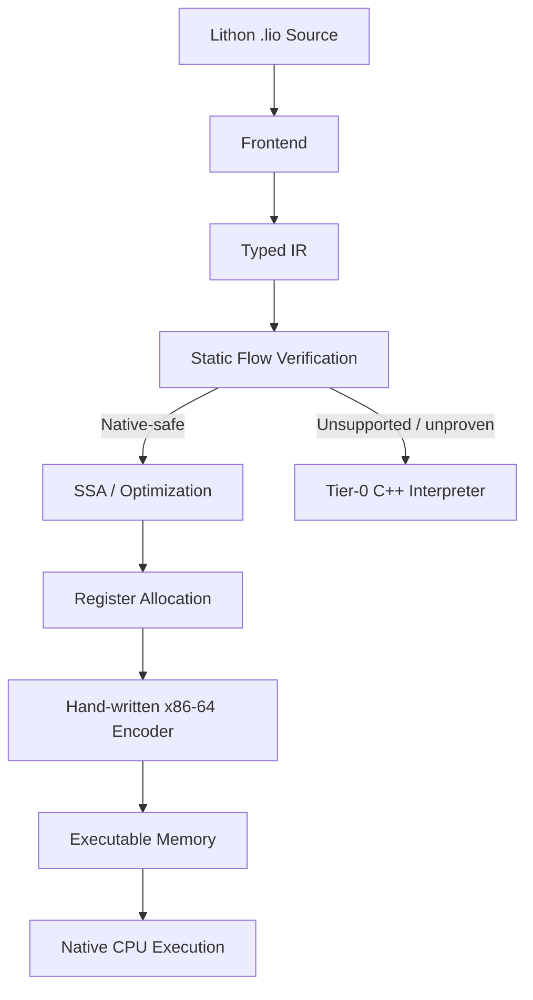

<div align="center">


# Lithon

### Native execution for typed Python.

[](https://github.com/Project-Lithon/lithon/actions)
[](https://en.cppreference.com/w/cpp/20)
[](https://en.wikipedia.org/wiki/X86-64)
[](#-static-typing)
[](LICENSE)

**Lithon is an experimental Python library and native x86-64 JIT that brings extended static typing, native execution, and explicit low-level memory access to Python code.**

</div>

---

<p align="center">
  
</p>

---

## 🚀 What is Lithon?

Lithon is a **Python library and native execution engine** that runs `.lio`
source code using an extended **PEP-526-style static typing syntax**.

Lithon is designed to keep Python's familiar source-code model while giving
the compiler explicit type information that can be used for static verification,
native machine-code generation, and predictable execution.

Lithon sources use the **`.lio`** extension. The syntax is deliberately
Python-shaped, but `.lio` is what marks a file as a Lithon program; the frontend
refuses any other extension, so a plain Python script is never silently compiled
as Lithon.

For example:

```python
x: int[64] = 10
y: int[64] = 20

result: int[64] = x + y

print(result)
```

### Current status

**Lithon is an experimental/community-preview project.**

The compiler is already executing substantial typed programs natively and has
a verification suite covering machine-code encoding, ABI correctness, static
analysis, SSA, register allocation, floating point, containers, pointers,
structs, AVX2 auto-vectorization, differential testing, and randomized
fuzzing.

It is **not yet a stable production library** and should not be treated as a
drop-in Python replacement.

### Recently added

- **Class references in containers (4.10.3)** — a `list[P, N]` or
  `tuple[P, N]` may now hold class references. Each element is one 8-byte
  reference leaf in the container's flat run, so a nested
  `list[list[P, 2], 2]` is still one contiguous run and `xs[i][j]` is the same
  multi-index access scalars use. The declared element class is the **static**
  type of every read: an element may name that class or any subclass (an
  upcast), so `xs[i].method()` dispatches on the object's real class, and
  `isinstance(xs[i], D)` still sees a stored `D`. A read is a **borrow**; the
  slot owns one reference. A class-typed literal must fill every slot (a bare
  declaration would be a run of null references), so a shorter literal, a bare
  `list[P, N]`/`tuple[P, N]`, and `append` are refused. Overwriting a slot
  retains the new reference *before* releasing the old one, so
  `xs[0] = xs[0]` and `xs[1] = xs[0]` cannot free the value being stored;
  scope exit walks the flat leaf chains in reverse and drops one reference per
  slot, which is what makes per-element `__del__` observable and tier-identical.
  Tuples build their elements first and then declare/fill the run in one block,
  because an element's inlined constructor splits the IR. `in`, `is`/`is not`
  and `==`/`!=` compare references (with the same related-class rule as
  identity); `len` reports the literal's slot count. Deliberately deferred:
  `enumerate`/`zip` over a class-typed container (the loop target outlives an
  iteration, so its ownership rule is not settled — use
  `for i in range(N):` and read `xs[i]`), class-typed containers as function
  parameters or return values (local storage, not a value), and dict
  keys/values of class type. `tests/typed_regression/class_container_list.lio`,
  `class_container_inherit.lio` and `class_container_lifetime.lio` guard the
  reads, dispatch/upcasts and per-slot lifetime, and `fuzz_diff.py --oop`
  alternates a container shape with the 4.10.1/4.10.2 shapes.
- **Single inheritance (4.10.2)** — `class Dog(Animal):` extends an earlier
  class. A subclass instance begins with a valid base instance (base attributes
  keep their offsets), so upcasting a `Dog` reference to `Animal` is free and an
  inherited attribute or method is reached without a copy. Method slots are
  **stable down the chain**: a call site compiled against the base reads the
  same slot for every subclass, and an override replaces that slot's
  implementation. A call whose receiver's exact class is statically known (and
  whose hierarchy has no override) is still inlined; when the receiver is only
  known as a base, the frontend emits `CallVirtual`, which reads the receiver's
  own descriptor and runs the override at run time. `super()` starts lookup at
  the enclosing class's base and inlines that implementation;
  `super().__init__(...)` runs the base constructor on the same object while
  registering the base's attributes with the derived definite-init check.
  `isinstance(x, C)` is two integer compares against C's subtree range (type ids
  are assigned pre-order, so every subtree is one contiguous interval);
  `issubclass(A, B)` folds to a constant at compile time. A method whose body is
  `...` is abstract: the class is flagged and cannot be instantiated until a
  subclass implements it. An override must match the inherited signature, and a
  subclass adds attributes rather than shadowing inherited ones. Multiple
  inheritance is 4.10.4. `tests/typed_regression/class_inherit.lio`,
  `class_inherit_super.lio`, `class_inherit_isinstance.lio` and
  `class_inherit_params.lio` are tier-identical guards, and `fuzz_diff.py --oop`
  now alternates flat class programs, inheritance programs and class-reference-
  in-container programs (vtable dispatch, `super()`, `isinstance`, upcasts,
  per-slot ownership).
- **Classes (4.10.1)** — the first user-visible slice of Python's object model.
  A `class Name:` with no base declares a real class: attributes with types, an
  `__init__`, plain methods, and an optional `__del__`. An instance is a heap
  **reference** (8 bytes) — distinct from a `struct`'s inline byte run — so it is
  a value that can be passed, returned, aliased and stored, and every method is
  inlined at its call site with `self` as the receiver reference (the 4.9
  model). Attribute access lowers to `refload`/`refstore` at absolute offsets
  baked in from the class layout, which the frontend emits once as module
  metadata both tiers read, so the two engines cannot disagree about a layout.
  Lifetime is the reference-counting model made observable: `p: Point = Point(...)`
  owns one reference, dropped at the exit of the block that owns it (a function
  or module body, a loop body, a `return` path, a `break`/`continue`); `b = a`
  and storing a reference in an attribute emit a retain so both owners count.
  Releasing an object also drops the references its own class-typed attributes
  hold, so an object kept alive *only* by a holder still dies, and its `__del__`
  runs, when the holder does. A function that returns a reference retains it, so
  a call result is always one owned reference the caller drops at its own scope
  exit — the same contract whether the callee returned a fresh construction, an
  owned local or a borrowed parameter, which removes the borrow ambiguity instead
  of inferring it.
  `__del__` is **not** inlined — it is emitted as a real `__del__<Class>`
  function and pointed at from the descriptor, so it runs at the exact last drop
  and in the same order in both tiers. `is`/`is not` and (until 4.10.5 adds
  `__eq__`) `==`/`!=` on two references are object identity: one integer compare
  of the addresses. Definite initialization is enforced structurally — every
  declared attribute must be assigned on every path reaching the end of
  `__init__` (E0140), and uninitialized scalar attributes are zeroed at `new`.
  An attribute is `int[w]`, `float[64]`, `bool` or a reference to another class
  — the declaration makes exactly those usable, so a `str`, `struct` or `enum`
  attribute (which would be stored inline but has no *variable* for the ops that
  reach a bounded string, a struct field or an enum payload) is refused at
  declaration (E0127) rather than accepted and then unreadable. Refused by
  design: a bare class name in a value position ("did you mean `Name(...)`?"),
  an undeclared attribute (E0141), and any decorator (4.10) — `property` and
  `classmethod` arrive as keywords in 4.10.6. Class-typed variables are non-null
  by default; `Optional`/`None` is a later sub-step. Class references may now
  be list/tuple elements (4.10.3); a dict, struct attribute or class attribute
  holding one remains a later sub-step.
  `tests/typed_regression/class_basic.lio`, `class_lifetime.lio`,
  `class_references.lio` and `class_returns.lio` are tier-identical guards, and
  `tools/fuzz_diff.py --oop` generates class programs and compares the two
  engines (and CPython) over construction, aliasing, lifetime and identity.
- **Object runtime (4.10.0)** — the foundation for real classes: a small
  `mmap`-backed heap with intrusive size-class free lists and no libc, the
  `[vptr:8][refcount:8]` instance header, a read-only `ClassDescriptor` carrying
  the type id, its subtree range and the vtable, and shared `IncRef`/`DecRef`
  helpers. **Reference counting** is the decided lifetime model: deterministic,
  pause-free, and the `__del__` moment is pinned to exactly the program point
  where the last reference drops — the one observable lifetime event, so the
  optimizer may not move or elide it, and the two tiers therefore agree. An
  object whose class has no `__del__` is a plain, freely-rewritable free;
  class descriptors and (later) stack-allocated objects carry an immortal
  sentinel so no increment is ever emitted for them. The runtime is shared by
  both tiers (`src/runtime/object.h`, `src/runtime/heap.h`) and reset at each
  entry point exactly like the stack-depth guard, so allocation and destructor
  order cannot drift between the interpreter and the JIT. This stage adds **no
  user-visible language change**; `src/runtime/object_runtime_test.cpp` pins the
  layout, the allocator, reference counting, the destructor timing/order, the
  immortal no-ops and the two-compare `isinstance` range. Documented narrowings:
  allocation addresses are never observable (a reference is print-unsafe, like
  `Ptr`), cycles leak, and references held between a trap and a `try` handler
  are leaked on the exceptional path (never a safety problem).
- **`try`/`except` (6.10)** — the Python EAFP rhyme works: a `try` body whose
  `int(8, input("..."))` meets a typo lands in `except ValueError:`, and the
  program continues. It catches the closed set of built-in Tier-3 traps
  (`ZeroDivisionError`, `OverflowError`, `ValueError`, `IndexError`,
  `KeyError`, `EOFError`, or `Exception` for every one of them) with `else` and
  `finally`. There is no exception object and no unwinding: a caught trap is a
  plain jump to the matching handler block, and the whole construct is ordinary
  control flow plus three markers both tiers read. That is also its one
  narrowing — only a trap raised in the **same function** as the `try` is
  catchable, because routing across a call boundary would need a real unwind.
  `except X as e`, `raise`, `except*` and a bare `except:` are refused.
  `tests/typed_regression/try_except.lio` and `try_except_eafp.lio` are the
  tier-identical guards.
- **`!=` (6.9)** — `ast.NotEq` is now a first-class compare, not an `==`
  followed by a `Not`. It mirrors `==` in typing and differs only in the result:
  a dedicated `Ne` IR op lets the optimizer, branch fusion and the print guard
  see the real predicate. The float path is the one with a machine-level trap:
  after `ucomisd`, `!=` is true when the operands differ **or** are unordered, so
  the JIT emits `setne OR setp` (fused: `jp` and `jne` to the same target) while
  `==` stays `sete AND setnp` — emitting only `setne` would make `nan != nan`
  false. Integers compare exactly as `int64`, `str` compares as a run
  (lengths-or-bytes, via `strne`), and `while i != n` loops are not strength-
  reduced or vectorized because `i != n` has no guaranteed trip count.
  `tests/typed_regression/ne.lio` is the byte-for-byte CPython guard.
- **Raw syscalls** — `syscall(number, a1..a6) -> int[64]`, one IR instruction
  and one host trampoline that *both* tiers call, so the calling convention
  cannot drift between them. Takes int[64] and pointers.
- **Networking (5.2)** — `socket`/`bind`/`connect`/`listen`/`accept`/`send`/
  `recv`/`close` as raw syscalls, with `&sockaddr_in` and send/recv buffers
  passed as pointers into real frame bytes. A single-process loopback round trip
  across a mid-flight `getsockname` is compared line-for-line against a
  libc-free C oracle, and the byte-swap failure mode is asserted explicitly.
- **Multi-argument `print`** — `print(a, b, c)` prints space-separated with one
  trailing newline, matching Python, and `print()` prints a bare newline. It is
  lowered to runtime pieces (`print_bare` / `print_sep` / `print_nl`), never a
  built string, so each tier formats each value exactly as before. `sep=` and
  `end=` are deferred.
- **Iteration helpers** — `enumerate`, `zip`, `sum`, `min`, `max`, `abs`, `any`,
  `all`, and `in`/`not in` over a list. All are rewrites over the compile-time
  capacity `N`, so there is no new opcode and no runtime helper. Cross-checked
  against CPython byte for byte.
- **Real pointers** — a `ptr[T]` is a genuine host address in the interpreter as
  well as the JIT, backed by per-variable byte storage that a syscall could
  read. `ptr[struct[N]]` forms, typechecks, compares, scales by `sizeof(Point)`,
  and **is read and written through** (`valueof(_p).x`) in both tiers — the JIT
  gained a general `[reg+disp]` encoder primitive, verified against GNU `as`
  over 18,379 cases, so pointer-base field ops run natively instead of falling
  back. `ptr_field.lio` and `ptr_alias.lio` are the regression guards.
- **Three type-system holes closed** — a bool literal stored into an `int`
  (`v: int[64] = True`) used to type-check clean and print `True`; a capacity-1
  list could not compile natively at all; and a loop target could silently
  change type between `for` headers.

---

## ✨ Why Lithon?

Lithon is built around several principles:

* **Python source with extended PEP-526 typing** — Lithon works directly with
  `.lio` source while providing additional type information to the native
  execution pipeline.
* **Mandatory static typing** — types are verified before execution.
* **Fixed-width values** — integer widths are explicit.
* **Native execution** — supported programs can execute as generated x86-64
  machine code.
* **No mandatory LLVM/Cranelift dependency** — the backend contains its own
  machine-code encoder.
* **Interpreter fallback** — unsupported native cases can still execute through
  Tier-0 when using automatic mode.
* **Explicit unsafe memory access** — pointer variables require an `_` prefix.
* **Managed objects, but no hidden pauses** — class instances live on a
  reference-counted heap (4.10.0), so aliasing (`b = a`) and objects outliving
  their creator work as in Python; there is no tracing collector and therefore
  no pauses. Dynamic dispatch exists only through declared class hierarchies,
  costs one indirect call, and is removed wherever the compiler can prove the
  type; objects live on the heap unless escape analysis proves they do not
  escape.
* **JIT/Compiler refusal over silent miscompilation** — when Lithon cannot prove
  something, the native tier refuses it.

The last point is fundamental to the project:

> **If Lithon cannot prove that a program satisfies the rules required by its
> native backend, it should refuse native compilation rather than guess.**

---

## 🧬 A Small Lithon Program

### Static integers

```python
a:int[64] = 20
b:int[64] = 22

result:int[64] = a + b

print(result)
```

Output:

```text
42
```

The width is part of the type:

```python
x:int[8] = 127
y:int[16] = 32000
z:int[64] = 9223372036854775807
```

Lithon does not silently turn these into arbitrary-precision Python integers.

Every integer width is **signed**: there is no `uint`. A negative `int[8]` /
`int[16]` / `int[32]` keeps its value when it is read back out of a list
element, a struct field, or a pointer, so `-5` stored into an `int[16]` prints
`-5`, never the zero-extended bit pattern `65531`. `bool` is the one narrow type
that is not signed: it reads back as `0` or `1`.

---

## 🧠 Static Typing

Lithon's type checker is **unconditional**.

Removing annotations does not disable verification.

For example:

```python
x = 10
```

is rejected when a declaration requires an explicit type.

Instead:

```python
x:int[64] = 10
```

The compiler also checks:

* definite assignment
* branch type compatibility
* return types
* integer widths
* narrowing conversions
* function parameters
* container element types
* pointer types
* struct field types
* enum variant and match rules
* type-function arity and expansion rules
* shift bounds
* container capacities

The principle is:

```text
Unknown / unprovable
        │
        ▼
     REFUSE
```

rather than:

```text
Unknown
  │
  ▼
Guess
  │
  ▼
     Generate potentially incorrect machine code
```

### Declaring without initializing

A declaration may omit the initializer. `x:int[8]` introduces the name and its
type without storing anything; the name starts **unassigned**:

```python
i:int[8]
i = 5
print(i)
```

This is accepted only where the name is definitely assigned before every read.
Reading it first is refused:

```text
RCR error: 'i' is not definitely assigned here (V1_SPEC 0.6.10)
```

An assignment inside one branch of an `if` does not count after it unless the
other branch assigns too, and a loop body never leaves a name assigned after the
loop. The first assignment is still range-checked, and the declaration emits no
code, so this generates exactly the same machine code as writing the initializer
in the declaration:

```python
i:int[8]
i = 5
print(i)
# same machine code as i:int[8] = 5 followed by print(i)
```

Re-declaring a name with a different type is refused: a name has one type.

---

## 🧷 Typed Pointers and Explicit Unsafe Variables

Lithon provides typed pointer values:

```python
i:int[16] = 16
_ptrI:ptr[int[16]] = addressof(i)

print(_ptrI)
print(valueof(_ptrI))
```

Example output:

```text
0x7fff330710e8
16
```

### Why the `_` matters

The `_` prefix is **mandatory** for pointer variables.

```python
_ptrI:ptr[int[16]] = addressof(i)
```

is valid.

A pointer variable without the required `_` prefix is rejected and does not
execute.

Likewise, a `_`-prefixed variable must satisfy the pointer rules.

This is Lithon's explicit unsafe-memory marker: the programmer can immediately
see which variables belong to the raw/native memory domain.

The mechanism is intentionally different from Rust's `unsafe` blocks, but the
design goal is similar:

> **Make potentially unsafe memory operations explicit instead of invisible.**

Current pointer support includes:

* `ptr[T]`
* `addressof()`
* `valueof()`
* typed pointer arithmetic
* compiler-enforced `_` naming
* static pointee typing
* protection against pointer promotion into ordinary registers
* frame-backed address stability

Pointers currently have deliberate restrictions. They cannot arbitrarily cross
function boundaries, point into unsupported containers, or be used as a generic
escape mechanism.

---

## ⚡ Native x86-64 Execution

Lithon's Tier-1 backend generates native x86-64 machine code directly.

The backend includes:

* hand-written x86-64 instruction encoding
* register allocation
* liveness analysis
* SSA / Phi handling
* branch emission
* stack-frame management
* floating-point SSE2 operations
* ABI-aware function calls
* CPU feature detection
* executable memory management

The generated code is placed into executable memory using the host operating
system's native facilities such as `mmap` / `VirtualAlloc`.

Lithon does **not** require LLVM or Cranelift to generate its native machine
code.

---

## 🏗️ Architecture

Lithon currently spans four implementation layers:

| Layer        | Language | Responsibility                                       |
| :----------- | :------- | :--------------------------------------------------- |
| **Frontend** | Python   | Source syntax, annotations, AST → IR                 |
| **Engine**   | C++20    | IR, type checking, analysis, optimization, execution |
| **Bridge**   | C        | ABI / native interoperability                        |
| **Backend**  | x86-64   | Machine-code encoding and emission                   |



---

## 🔀 Dual-Tier Execution

Lithon has two execution tiers.

### Tier-1 — Native

The preferred path.

```text
Lithon source
    ↓
Typed IR
    ↓
Static verification
    ↓
Optimization
    ↓
Register allocation
    ↓
x86-64 machine code
    ↓
CPU
```

### Tier-0 — Interpreter

The fallback path.

If a program uses functionality that the native backend cannot currently
support, automatic mode can execute it through the C++ interpreter.

This is useful during language development because unsupported features do not
have to block the entire execution pipeline.

### Strict mode

Use:

```bash
lithon program.lio --strict
```

`--strict` means:

> **Native execution only. Refuse if Lithon cannot compile the program to the
> native tier.**

This is particularly useful for testing the compiler because successful output
cannot hide an interpreter fallback.

---

## 📦 Python Package

Lithon is being developed as a **Python library / package**, with a command-line
interface for compiling and running Lithon programs.

The project is **not yet released as a stable PyPI package**.

During development, the repository can be installed in editable mode:

```bash
pip install -e .
```

Then:

```bash
lithon program.lio
```

Useful commands:

```bash
lithon program.lio
lithon program.lio --strict
lithon program.lio --ir
lithon program.lio -v
```

The current development package layout is still being consolidated before the
first public package release.

---

## ⚡ Quickstart

### Requirements

* CMake ≥ 3.20
* C++20 compiler
* Python ≥ 3.10
* x86-64 Linux or Windows environment for the current native backend

The C++ engine itself does not depend on LLVM or Cranelift.

### Build

```bash
git clone git@github.com:Project-Lithon/lithon.git
cd lithon

cmake -B build -DCMAKE_BUILD_TYPE=Release
cmake --build build -j$(nproc)
```

### Run through the development CLI

```bash
pip install -e .

lithon tests/programs/float.lio
```

Native-only:

```bash
lithon tests/programs/float.lio --strict
```

Print IR:

```bash
lithon tests/programs/float.lio --ir
```

Verbose execution information:

```bash
lithon tests/programs/float.lio -v
```

---

## 🧪 Verification

Lithon places unusually strong emphasis on **differential testing and
machine-level verification**.

The project does not consider "the program printed the expected number" enough
to prove that the native backend is correct.

The verification suite checks several independent layers.

### Current verification highlights

| Area                                 |         Current result        |
| :----------------------------------- | :---------------------------: |
| CTest                                |       **35 / 35 passed**      |
| x86-64 encoder comparisons           |       **18,379 cases**        |
| Incorrect encoder cases              |             **0**             |
| Typed differential fuzzing           |      **300 / 300 passed**     |
| Bitwise / shift fuzzing              |      **200 / 200 passed**     |
| Conditional-expression / SSA fuzzing |    **200 / 200 per suite**    |
| Direct float Phi sweep               | **88 matched / 0 mismatched** |
| ABI modules audited                  |             **34**            |
| ABI stack/callee-saved failures      |             **0**             |
| Typed regression suite               |       **57 / 57 passed**      |
| General regression suite             |       **34 / 34 passed**      |
| Type-checker unit checks             |          **145 ok**          |
| Error-code discipline checks         |         **151 ok**           |
| Tier differential (interp vs JIT)    |      **227 / 227 passed**     |
| Object runtime (4.10.0–4.10.3, ctest) | **77 ok**       |
| Class (OOP) fuzzing                  |      **200 / 200 passed**     |
| Syscall hook parity (both tiers)     |        **4 / 4 passed**      |
| Networking loopback vs a C oracle    |          **verified**        |
| SIMD vectorizer loop cases           |        **6 / 6 passed**      |
| SIMD vectorizer gate + fallback      |          **verified**          |

The full verification gate concludes:

```text
ALL CHECKS PASSED
```

### Encoder verification

The hand-written x86-64 encoder is compared against GNU `as`.

Current comparison:

```text
9239 instruction cases
7949 byte-identical
1290 different but valid encodings
0 incorrect encodings
```

A byte difference is not automatically considered an error because x86-64
often has multiple valid encodings for the same instruction.

The important number is:

```text
WRONG = 0
```

### Differential testing

Native output is compared against the Tier-0 interpreter.

This catches errors where:

```text
compiler accepts program
        ↓
machine code executes
        ↓
but machine code produces wrong result
```

Randomized programs are generated specifically to exercise:

* arithmetic
* control flow
* SSA merges
* loops
* floating point
* bitwise operations
* shifts
* modulo
* register allocation
* optimization passes

### ABI verification

The native backend checks:

* stack alignment
* call boundaries
* return boundaries
* callee-saved register preservation

Compiled modules are disassembled and audited rather than merely assumed to
follow the ABI.

---

## 🧮 Floating Point

Lithon currently supports `float[64]` through the native pipeline.

Supported operations include:

* addition
* subtraction
* multiplication
* division
* modulo
* comparisons
* function arguments
* function return values
* native printing

The implementation uses SSE2 instructions and performs explicit handling for
cases such as:

* NaN comparisons
* NaN divisors
* positive and negative zero
* division by zero
* floating-point formatting
* values crossing function calls

Float formatting is shared between the interpreter and native runtime so that
both tiers produce identical textual output.

---

## 📚 Containers

### Lists

Fixed-capacity lists are supported:

```python
xs:list[int[32],4]
```

The capacity is static and the layout is packed according to element width.

Currently supported list operations include:

```python
xs:list[int[32],4]

xs[0] = 10
xs[1] = 20

print(xs[0])
print(xs)        # [10, 20, 0, 0]
print(len(xs))
```

Bounds are statically checked when possible and dynamically trapped when the
index is only known at runtime.

#### The live length (6.7)

A list still has a fixed capacity, but it also carries a **run-time length**: a
companion `int[64]` holding how many leading slots are live. A literal counts the
slots it names, so its trailing slots stay zeroed and are not part of the list:

```python
xs: list[int[64], 6] = [1, 2, 3]
print(len(xs))    # 3   (not 6)
print(xs)         # [1, 2, 3]
print(sum(xs))    # 6   (only the live prefix)

xs.append(4)      # writes slot 3, advances the count to 4
xs.append(5)      # ... and slot 4
print(xs)         # [1, 2, 3, 4, 5]
```

A bare declaration is the all-zero list with every slot live, so `len` is the
capacity. `len(xs)` reads the companion, `print(xs)` renders only the live
prefix, and the reductions `sum`/`min`/`max`/`any`/`all` and `x in xs` scan the
live prefix. Because those are unrolled over a compile-time length, appending
inside a loop — which makes the length run-time-only — refuses them
(`E0114`/`E0115`/`E0119`). `append` onto a full list traps
(`list index out of range`) in both tiers, and a statically-known "already full"
append is refused (`E0111`).

### Tuples

Homogeneous immutable tuples are supported:

```python
t:tuple[int[64],4] = (1, 2, 3, 4)

print(t[2])
```

Tuple construction must initialize all elements.

Writes after construction are rejected by the type checker.

### Dictionaries

Fixed-capacity dictionaries use open addressing:

```python
d:dict[int[64], int[64], 4] = {
    1: 10,
    2: 20
}
```

The table has a compile-time capacity and does not require a dynamically growing
heap structure.

Supported operations include:

* literal construction
* lookup
* `contains`
* fixed-capacity hashing
* collision resolution
* deterministic miss traps

Mutation after construction is intentionally not currently supported.

A key is an `int` (any width up to 64), a `bool`, or a bounded string (6.8):

```python
k: str[16] = "name"

d: dict[str[16], int[64], 4] = {"name": 1, "age": 2}
print(d[k])          # 1   (a str variable names the key's run)
print(d["age"])      # 2   (a literal is materialised into its own run)
print(contains(d, "zz"))
```

A str key is not a scalar, so it has no register form: the operand is the *name*
of the key's byte run, and the probe is a byte hash and a byte comparison rather
than a multiply and a word compare. Both tiers run the **same** walk, so a str
key does not merely hash the same way in each tier — the two cannot disagree,
because there is one function (`dict_str_probe`) behind both. Because a key is
copied into a fixed `str[N]`-wide slot, a key's *capacity* must not exceed the
table's key capacity; a literal of `L` bytes also needs `L < N`, exactly as it
would as a `str[N]` assignment. Table order and bucket (memory) order coincide,
so a whole-dict `print` of a str-keyed table is deterministic but not insertion
order.

A value is a scalar (`int`, `float`, `bool`, `str[N]`) or a container — a `list`
or a `tuple` (6.9):

```python
d: dict[int[64], list[int[64], 4], 4] = {1: [10, 20, 30, 40]}

print(d[1][0])    # 10   (the value is read out into a run, then indexed)
print(d)          # {1: [10, 20, 30, 40]}
```

A container value has no scalar form, so it is not stored in a register: the
table's value region is a flat run of leaf cells (`buckets × leaves`), and the
value is copied in and out of one bucket's slice as a whole — from a run at
construction, into a run on a read. The copy moves whole leaves at the leaf's
own width (8, 4, 2 or 1 bytes, whichever divides the remaining run), not whole
8-byte slots, because the leaves are packed: `list[tuple[int[32],4],2]` is eight
4-byte leaves, and a slot-at-a-time copy would read past the run and skip every
other leaf. A value of 1000 reads back as 1000, not as `1000 mod 256`. Both tiers
copy exactly the same leaves, so a nested value prints identically. A `dict`
value is still refused (it has three regions, so it has no single leaf run a
value slot could hold).

### Strings (6.2)

Bounded strings are supported:

```python
s: str[8] = "hi"

print(s)        # hi
print(len(s))   # 2
print(s[0])     # 104  ('h' as an int[8] byte)

s[1] = 73       # write a byte -> "hI"
print(s)        # hI

t: str[8] = "hI"
print(s == t)   # True
```

A `str[N]` is exactly `N` bytes of NUL-terminated storage — the same packed
byte run a `list[int[8], N]` would be — so the content is the bytes before the
first `0x00`, `len(s)` is the run-time byte count (capped at `N`), and `print(s)`
writes those bytes as text. A literal of `L` bytes needs `L < N`, since the last
byte is the terminator; a bare `s: str[8]` is the empty string. `s[i]` reads or
writes one `int[8]` byte, `len(s)` raises to a full `int[64]`, and `s == t` is a
byte-for-byte comparison that may span **different capacities**. Both the
interpreter and the JIT run the same byte scan, so a string prints and compares
identically in either tier.

Two substring scans complete the string surface (6.4):

```python
s: str[16] = "hello world"

print(s.find("world"))   # 6     (lowest index, or -1 when absent)
print(s.find("z"))       # -1
print(s.count("l"))      # 3     (non-overlapping matches)
print(s.count(""))       # 12    (len(s) + 1, as in Python)
```

`s.find(sub)` returns the lowest index of `sub` or `-1`; `s.count(sub)` counts
non-overlapping occurrences. The needle is a string literal or another `str`
variable, and its capacity need not match the haystack's. The empty needle is
the Python edge: `find` returns `0`, `count` returns `len(s) + 1`. Both scans
read the same NUL-terminated byte runs `s == t` does, so they agree byte for
byte across the two tiers.

The one way to take a string apart is `str.split` (6.7). A list is a declared
run, not a value, so the pieces have to be named somewhere: the destination is
declared on the left, and the split writes into it.

```python
s: str[32] = "a,bb,ccc"

parts: list[str[8], 4] = s.split(",")
print(len(parts))    # 3
print(parts)         # ['a', 'bb', 'ccc']

t: str[4] = "::"
q: list[str[8], 4] = "x::y::z".split(t)   # a str variable separator too
print(q)             # ['x', 'y', 'z']
```

`s.split(sep)` fills the destination and sets its length companion, so `len` and
`print` see exactly the pieces produced — including empty ones, so `",a,b,"`
splits into `['', 'a', 'b', '']`. A piece longer than `K-1` bytes is truncated
to fit its `str[K]`, and a split that produces more than `M` pieces traps
(`too many pieces for the list (str.split)`) rather than dropping any silently.
The whitespace-splitting form `s.split()` and an empty separator are refused, so
the separator is always explicit.

#### A string is a leaf type

Because a `str[N]` is just a byte run, it can be *anywhere* a scalar element can
be: a list or tuple element, a struct field, or a pointer's pointee.

```python
words: list[str[8], 3] = ["one", "two", ""]
print(words[1][2])        # 111  ('o' of "two")
words[1][2] = 88          # -> "twX"

class Named(struct):
    name: str[8]
    n: int[8]

c: Named
c.name = "hi"
print(len(c.name))        # 2
c.name[0] = 120           # -> "xi"

s: str[8] = "hi"
_p: ptr[str[8]] = addressof(s)
print(valueof(_p))        # hi   -- the pointer names s's run
print(len(valueof(_p)))   # 2
```

A struct's `str` field lives in a *companion byte run* named by the dotted
attribute path (`c.name`), declared right after the struct's own blob; a nested
field is named by the whole path, so `o.inner.tag` is one run too. A `str[N]`
pointer names the string it was minted from, so `valueof(_p)` denotes that
string's place rather than a scalar — every string operation works through it.
A field reached through a pointer *into the struct* (`valueof(_pp).name`) is
refused: the companion run is keyed by the variable name, so there is no run to
name there.

#### Printing a nested string

A string printed **directly** — a bare variable, or a struct field — prints its
bare contents. A string that appears **inside an aggregate** (a list or tuple)
prints the way Python's `repr` does: quoted, with the same backslash escapes
CPython uses.

```python
s: str[8] = "hi"
print(s)                       # hi        (bare, top level)

pair: tuple[str[8], 2] = ("hi", "a b")
print(pair)                    # ('hi', 'a b')   (repr, nested)
```

Both tiers produce byte-identical output for both forms.

#### Printing string literals and f-strings (6.3 Stage A)

A string literal may be printed directly, and an f-string may be used inside
`print`. Neither builds a string value: a constant chunk is written into a
shared bounded run and printed through the same top-level path `print(s)` uses,
while `{expr}` is printed by the ordinary value printer, so a `%` or a brace in
a literal is just a byte and floats use the one shared shortest-round-trip
formatter.

```python
x: int[32] = 3
s: str[16] = "world"

print("hello")                 # hello
print("x is:", x)              # x is: 3        (arguments are space-separated)
print(f"x is {x}")             # x is 3         (f-string pieces are adjacent)
print(f"{{x}}={x}")            # {x}=3          ({{ }} escape a brace)
print("100%")                  # 100%
```

`{{` / `}}` escape a literal brace **inside an f-string only**; in a plain
string literal they are two ordinary braces, exactly as in Python. A format
specifier (`{x:.2f}`), a conversion (`{x!r}`) and `{x=}` are refused rather than
printed wrong. An f-string used as a *value* (`s: str[64] = f"x={x}"`) is Stage
B and is not implemented yet.


### Printing and nesting

`print(xs)` renders a whole container the way Python's `repr` does — `[10, 20,
30]` for a list, `(1, 2, 3)` for a tuple (with the one-element trailing comma
`(1,)`) — in both tiers, and a `dict` prints in bucket (memory) order.

Containers **nest**: an element may itself be a list or tuple, so
`list[list[int[64], 4], 2]` and `list[tuple[int[64], 3], 4]` are legal and a
nested `dict` is refused (a dict has no flat scalar leaf). The layout is a flat
run of scalar leaves, so `xs[i][j]` is a single indexed access at the summed
byte offset — there is no intermediate container object. Reads, writes and
`print` all descend to the deepest leaf; a partial index chain like `xs[i]` on a
nested container is refused.

A container is *storage, not a value*. It is built by its declaration plus
`IndexStore`s, and there is nothing to copy, so `z = ys` (two lists) and
`xs[0] = a` (a container element) are refused at compile time rather than
miscompiled.

---

## 🧱 Structs

A struct is a named run of typed fields packed into one blob of bytes. It is
spelled as a class deriving from `struct`, whose body is nothing but field
annotations:

```python
class Point(struct):
    x: int[64]
    y: int[64]

p: Point
p.x = 3
p.y = 4
print(p.x)
print(p.y)
```

The declaration `p: Point` reserves and zeroes the bytes. A struct **has no
value** — the only operations are reading and writing fields, and the whole
struct is never an expression you can print or assign.

Fields are laid out end to end at exactly the offsets their sizes imply, with
**no padding** (a `bool` is 1 byte, `float[64]` is 8, `int[w]` is `w / 8`), so
the layout is a pure sum of field sizes and matches a C `#pragma pack(1)`
struct byte for byte.

```python
class SockAddrIn(struct):
    family: int[16]   # offset 0
    port: int[16]     # offset 2
    addr: int[64]     # offset 4
    active: bool      # offset 12

s: SockAddrIn
s.family = 2
s.port = 80
s.addr = 16909060
s.active = True
```

A field may be a scalar (`int[w]`, `float[64]`, `bool`) or a struct declared
earlier; a nested struct is flattened, so `seg.a.x` is a single read at the
summed byte offset. Containers, pointers, whole-struct values, and struct
parameters/returns are refused.

`tools/check_struct_layout.py` compiles the same struct definitions with a C
compiler and asserts the frontend's offsets and sizes equal the C
`offsetof`/`sizeof` values, field by field.

---

## 🏷️ Enums

An enum is a tagged union: a byte blob holding an `int` tag plus room for the
payload of whichever variant is active. Like a struct it **has no value** —
the only operations are constructing a variant, reading the tag with `match`,
and reading a payload through the arm's binding. It is spelled as a class
deriving from `enum`:

```python
class Shape(enum):
    Empty
    Dot
    Line: int[32]
    Rect: int[64]

s: Shape
s = Shape.Dot
match s:
    case Shape.Empty:
        print(0)
    case Shape.Dot:
        print(1)
    case Shape.Line(n):
        print(n)
    case Shape.Rect(w):
        print(w)
```

A variant is a bare unit name (`Empty`), a `name: type` scalar payload
(`Line: int[32]`), or an inline `class V(struct)` struct payload. The layout is
`[tag][payload]` with **no padding**: the tag is an `int[8]` while the enum has
at most 128 variants and widens to `int[16]` past that, the payload starts at
the tag width, and the size is the tag width plus the largest payload. Only the
active variant's bytes are ever read, so overwriting a payload variant with a
smaller one leaves stale bytes that no `match` can observe.

A `match` must be exhaustive — every variant covered, or a final `case _:`. It
lowers to a tag `fieldload`, an equality test, and a branch per arm, reusing the
struct machinery; there is no new IR. A struct field may be an enum
(`c.proto = Endpoint.Tcp(port=8080, addr=16777343)`), but list elements, enum
parameters/returns, enum-typed payloads, and `case` guards are refused.

`tools/check_enum_layout.py` compiles an equivalent C `#pragma pack(1)`
tag-plus-union and asserts the frontend's tag width, payload offset, and size
equal the C `offsetof`/`sizeof` values at both tag-width boundaries.

---

## 🔧 Methods

A `def` inside a struct or enum body is a **method**. The first parameter is the
implicit receiver `self`; the rest are annotated scalars, and the return type is
optional. A method is called as `recv.name(args)`.

```python
class Counter(struct):
    value: int[64]

    def add(self, n: int[64]) -> int[64]:
        self.value = self.value + n
        return self.value

    def total(self, n: int[64]) -> int[64]:
        t: int[64] = 0
        i: int[64] = 1
        while i < n + 1:
            t = t + i
            i = i + 1
        return t


c: Counter
print(c.add(5))
print(c.total(4))
```

A method call is **inlined at the call site**: `self` becomes the receiver place,
the method's parameters and locals are renamed so they cannot collide with the
caller's, and its `return` stores the result and jumps to the end of the inline.
Inlining is forced by the storage model — a field access names a variable, not a
value, and a struct or enum cannot be passed to a function (E0124) — and it is
what lets a method read *and write* the receiver's fields, keep its own locals,
run loops and branches, and call other methods. The receiver can be a struct or
enum variable or a struct/enum field (`o.inner.bump(1)`), and an enum method
reads `self` with `match self`.

Because the body is expanded at each call site, a method cannot recurse,
directly or indirectly (E0135). A method signature is scalars only
(`int[w]`/`float[64]`/`bool`): a method may not take or return a struct, an
enum, a container or a pointer, and `self` is unannotated. There is no
inheritance or overloading, a method name may not shadow a field or a variant,
and the signature accepts no `/`, `*`, `**` or defaults (E0134).

```python
class Shape(enum):
    Empty
    Line: int[32]

    def code(self) -> int[64]:
        match self:
            case Shape.Empty:
                return 0
            case Shape.Line(n):
                return n
            case _:
                return -1
```

`tools/check_methods.py` proves the transparency claim: it compiles a
method-using program and the same program with the bodies inlined by hand and
requires both tiers to produce identical output, checks the IR is deterministic,
and checks the E0134/E0135 refusals.

---

## 🧩 Type Functions

A type function is a **compile-time type constructor**: `def Name(params) ->
newtype` returns `{ T }`, and writing `Name(args)` anywhere a type is allowed
substitutes the arguments into `T` and yields an ordinary type.

```python
def Fixed(t, n) -> newtype:
    return {list[t, n]}

def Word() -> newtype:
    return {int[32]}

def Ref(t) -> newtype:
    return {ptr[t]}

xs: Fixed(int[64], 4)      # == list[int[64], 4]
w: Word()                  # == int[32]
_p: Ref(int[64])           # == ptr[int[64]]
```

The result is **structural** — `Alias(int[64])` and `int[64]` are the same
type, so nothing about a type function survives into the IR: compiling the
program above and the same program with the three types spelled out produces
byte-identical IR. The parameters hold **types and sizes** (they are
unannotated names), not runtime values; a definition carries no code and is
invisible to the runtime.

Applications nest (`Pair(Word())`) and work anywhere an annotation does:
function parameters and returns, struct fields, and container element types.
The body must be exactly one `return { <type> }` — `{}` is a dict and is
refused, as are multi-element bodies, comprehensions, decorators, annotated or
defaulted parameters, redeclarations, and names that collide with a struct, an
enum or a function. A body composes the value types an annotation can spell —
scalars, containers, pointers and dicts — and may not name a struct or an enum,
which are storage rather than values. A type function must bottom out in a
concrete type, so direct and mutual recursion are refused.

`tools/check_typefunc.py` proves the structural claim: it compiles a
type-function program and its spelled-out equivalent and requires the IR to be
byte-identical, then checks memoization and the E0132/E0133 refusals.

---

## 🧠 SSA and Optimization

Lithon's compiler is progressively moving from a memory-based IR toward SSA.

Current components include:

* CFG construction
* dominator analysis
* natural-loop analysis
* loop canonicalization
* Phi placement
* Mem2Reg
* SSA copy propagation
* dead-value elimination
* liveness analysis
* interference-graph register allocation
* Phi register coalescing
* direct Phi lowering
* constant folding
* dead-code elimination
* loop strength reduction
* accumulator unrolling
* optional floating-point reassociation
* AVX2 auto-vectorization of int32 loop bodies (CPUID-gated scalar fallback)

### Direct Phi support

Phi handling is now implemented as an opt-in native path:

```bash
lithon program.lio --strict
```

with the compiler's direct-Phi development path available through the relevant
backend flags.

The default memory-based lowering remains available because the project uses
the two paths as a differential-testing surface.

### Floating-point reassociation

Lithon deliberately keeps floating-point reassociation **off by default**.

The opt-in:

```bash
--ffast-math-equivalent
```

can shorten floating-point dependency chains, but it may change the numerical
result.

For example:

```text
interpreter                     2.0
native                          2.0
native --ffast-math-equivalent  1.0
```

This behavior is intentional and documented rather than hidden behind a generic
"optimization" switch.

---

## ⚡ SIMD Auto-Vectorization

The native backend can fuse a canonical elementwise or reduction loop over a
fixed-capacity `int[32]` list into **8-wide AVX2** lanes.

The compiler recognizes the range-loop shape the `while`/`for` lowering
produces — a small rotatable header (`i < N`), a straight-line body with a
single element read/write and one integer op, and a `i = i + 1` latch — and
replaces it with:

* a **CPUID gate** (`has_avx2()`), read from an int32 constant pool appended
  to the module;
* an 8-wide **vector main loop** of `vmovdqu` / `vpaddd` | `vpsubd` |
  `vpmulld` over `N - N%8` elements (reductions run a `vpxor` +
  `vextracti128` + `vpshufd` halving merge);
* a scalar **tail** for the last `N%8` elements;
* the untouched **scalar header as a fallback**, so on any host without AVX2
  the exact scalar code path still runs.

Key properties:

* The vector slices are byte-for-byte what the encoder emits and
  `check_encoder_vs_as.py` verifies; the unit test re-encodes the register
  core and proves the bytes are present, and absent from the scalar build.
* 32-bit lanes are **exact** for every program the typechecker accepts: only
  `int[32]` lists vectorize, so no wider-than-lane math can be reordered into
  a different overflow.
* Reductions are recognized only when the accumulator really is `int[32]`
  (verified from IR width annotations), so the 32-bit lane adds and the
  horizontal merge re-widen exactly.
* `vzeroupper` is emitted before any `Call` or `Return` in a function that
  used the vector path (audited by `check_vex_transitions.py`).
* `--no-vectorize` disables the pass; it also needs loop rotation, so
  `--no-rotate` disables it too (the fallback header is the rotated back edge).

A loop the recognizer cannot prove safe is left scalar — the vectorizer
refuses rather than guesses.

---

## `%` Is Not Python's `%`

Lithon deliberately uses **C-style truncating remainder semantics**.

```python
print(-7 % 3)   # Lithon: -1
print(7 % -3)   # Lithon: 1
```

CPython instead uses floor-division semantics:

```text
Lithon / C-style:  remainder follows the dividend
Python:            remainder follows the divisor
```

This is an intentional language-design decision.

---

## 🔀 Integer Operations and Shifts

Integer operations operate on fixed-width machine integers.

Supported bitwise operators:

```python
&
|
^
<<
>>
```

Right shift is arithmetic.

Shift counts must remain within the valid machine range:

```text
0 <= shift < 64
```

A constant invalid shift is rejected at compile time, while a dynamic invalid
shift traps at runtime rather than relying on x86's implicit masking behavior.

This keeps the language semantics explicit instead of accidentally inheriting
the CPU's register-level behavior.

---

## 🔌 Raw Syscalls

Lithon can invoke the platform's raw syscall primitive directly:

```python
uid: int[64] = syscall(102)   # getuid() on Linux/x86-64
```

`syscall(number, a1, a2, a3, a4, a5, a6)` takes a syscall number and up to six
arguments and returns the kernel's **raw** result as `int[64]`. On Linux a
failure is a negative `-errno`; nothing is wrapped and nothing is checked — a
program that wants to handle failure compares the result itself. There is no
`syscall` function to import: it is a compiler-recognized name that lowers to a
single `Syscall` IR instruction.

Both tiers execute it through one shared host trampoline
(`src/jit/syscall_runtime.h`), so the calling convention cannot drift between
the interpreter and the JIT. That trampoline consults an embedder-installed
hook first, on every platform; with no hook it runs the actual x86-64 `syscall`
instruction on Linux, and on a platform whose raw ABI is not stable (Windows)
returns `-ENOSYS` rather than guessing.

**Current restriction:** arguments are integers in this slice. A pointer
argument is refused at typecheck, because the interpreter represents pointers as
synthetic addresses rather than real memory, so a syscall that takes a pointer
(`write`, `read`) could not behave the same in both tiers. Pointer-taking
syscalls are deferred until the interpreter grows a real address-space story.

---

## 🛡️ Safety Philosophy

Lithon is not trying to eliminate low-level programming.

It is trying to make low-level programming **explicit and statically
constrained**.

The compiler therefore prefers:

```text
prove → compile
```

over:

```text
guess → compile → hope
```

Examples include:

* mandatory variable annotations
* fixed-width integers
* static narrowing checks
* definite-assignment analysis
* fixed container capacities
* packed, statically-laid-out structs
* typed pointers
* explicit `_` pointer naming
* compile-time shift validation
* ABI verification
* native/interpreter differential testing

The unsafe-memory model is intentionally visible:

```python
_ptr:ptr[int[64]]
```

rather than hiding the fact that a variable contains a raw address.

---

## 🆚 How Is Lithon Different?

| Feature               | CPython              | Cython / mypyc              | PyPy           | **Lithon**                |
| :-------------------- | :------------------- | :-------------------------- | :------------- | :------------------------ |
| Syntax                | Python               | Python                      | Python         | **Python-shaped `.lio` + Extended PEP-526**           |
| Primary execution     | Bytecode interpreter | C extensions                | Tracing JIT    | **Native x86-64**         |
| Static typing         | No                   | Optional                    | No             | **Mandatory**             |
| Fixed-width integers  | No                   | Possible                    | No             | **Built-in**              |
| Raw typed pointers    | No                   | Via C                       | No             | **Built-in**              |
| Native backend        | No                   | C/C++                       | JIT runtime    | **Custom x86-64 emitter** |
| LLVM required         | No                   | No                          | No             | **No**                    |
| Interpreter fallback  | Yes                  | N/A                         | Yes            | **Yes**                   |
| SSA compiler pipeline | No                   | External/compiler-dependent | Internal JIT   | **Yes**                   |
| Current target        | Cross-platform       | Cross-platform              | Cross-platform | **x86-64**                |

Lithon is not intended to replace Python's enormous ecosystem.

Instead, it explores a different point in the design space:

> **What if Python code could retain its familiar source model while giving the
> execution engine explicit static types, fixed-width values, native execution,
> and controlled low-level memory access?**

---

## 🎯 Potential Use Cases

Lithon is particularly interesting for programs where predictable native
execution matters:

* numeric algorithms
* tight computational loops
* low-latency utilities
* systems-oriented tooling
* performance-sensitive data processing
* experimental compiler research
* native execution experiments
* educational work involving compilers and machine code

Performance claims should always be treated as workload-dependent.

Lithon is **not** currently claiming that every Python program will run faster
than CPython, PyPy, Cython, Rust, or C++.

---

## 🔢 Iteration Helpers

`enumerate` and `zip` work in a `for` header:

```python
for i, x in enumerate(xs):
    print(i)
    print(x)

for a, b in zip(xs, ys):
    print(a)
    print(b)
```

Neither is a value. Both are a **rewrite of a counted loop** over constructs that
already exist: `for i, x in enumerate(xs)` becomes `for i in range(N): x = xs[i]`,
and `for a, b in zip(xs, ys)` becomes the same loop bounded at `min(N1, N2)` — a
compile-time constant, because the declared capacity is what `len()` folds to.
So there is no new opcode and no runtime helper; `zip` costs nothing beyond the
indexed loads it already emits.

Two consequences worth stating plainly:

- **`zip` stops at the shortest input**, exactly as Python does. `zip(xs, ys)`
  over a `list[..., 6]` and a `list[..., 3]` runs three times.
- **`enumerate` and `zip` are for-header only.** `z = zip(a, b)` is refused: the
  pair never needs to exist as a value, and a homogeneous tuple could not
  represent `enumerate`'s `(int, T)` anyway.

Elements bind with their declared type, so a `float[64]` list yields floats and
a `list[int[16], N]` stays signed. `break` and `continue` work inside either
header, because the rewrite is a real loop.

### 🧾 Divergences from Python

Deliberate narrowings, collected next to `%` and `v == n`:

| Construct | Python | Lithon | Why |
|---|---|---|---|
| `%` | remainder, sign follows the divisor | truncation toward zero; zero divisor traps (`E0301`/`E0302`) | signed machine remainder is not total |
| `v == n` | value equality | not supported | equality on machine values has no total answer |
| `zip` / `enumerate` | first-class iterators, usable as values | for-header only | a rewrite of a counted loop; the pair is never a value |
| `x in xs` on a list | membership, over any element type | membership over int/float/bool lists | it lowers to `==`; an aggregate or `str` element has no scalar `==` |
| `a == b` on two bools | `True == 1` | same: a bool compares as `0/1` in both tiers | a bool is a 1-byte scalar, not a distinct incomparable type |
| `v in xs` on a `bool` list | membership | supported | same `==` over the `0/1` value |
| `print(a, b)` | space-separated, one trailing newline | supported; `sep=` / `end=` not yet | the default separator and newline are runtime calls; a configurable one needs string values |
| f-strings | any expression, format specs, `!r` | in `print` only (Stage A); `{expr}` for int/float/bool/str, `{{`/`}}` escapes | a format spec / conversion needs a runtime formatter; an f-string *value* needs a bounded buffer |
| `print("literal")` | prints the text | supported | the bytes are materialised into a bounded run and printed through the `str` path; no string value is built |
| `print(_p)` | a stable address | prints an address, but it differs per tier | real addresses cannot be byte-comparable across tiers |
| a dangling `_p` | undefined | undefined, and now a `SIGSEGV` | out of scope by design, not tracked by the compiler |
| string literals | unbounded `str`, any operation | `str[N]` bounded strings: literal construction, `print`, `len`, `s[i]` read/write of one `int[8]` byte, `s == t`; usable as a list/tuple element, a struct field or a `ptr` pointee | the capacity must be declared, so a string is a fixed byte run with no heap |
| a list literal shorter than its capacity | the list has exactly the elements written | the trailing slots stay zeroed and are **not** live: `len`/`print`/a reduction see only the named elements | the run is fixed-size and zeroed, and the live count is a separate companion |
| `xs[i] = v` on a list | grows the list if `i` is past the end | unchanged length; `i` must be in `0..cap-1` or it traps | the length is advanced by `append`, not by an indexed store |
| `list.append(v)` | amortised O(1), unbounded | writes the next live slot; a full list traps (`list index out of range`) | the capacity is fixed, so growth has no storage to run to |
| `list.append(v)` inside a loop | — | makes the length run-time-only, which refuses `sum`/`min`/`max`/`any`/`all`, `in`, `enumerate` and `zip` over that list (`E0114`/`E0115`/`E0119`) | those are unrolled over a compile-time length; a run-time bound has none |
| `s.split(sep)` | returns a new `list[str]` | `parts: list[str[K], M] = s.split(sep)` writes into a declared list; a piece longer than `K-1` bytes is truncated, and more than `M` pieces traps | a list is a declared run, not a value, so the destination is named; the pieces are bounded strings |
| `s.split()` (whitespace) | splits on runs of whitespace | refused (`E0114`) | the default form needs a whitespace-class scan; an explicit separator is the one this slice implements |
| a `dict` | mutable, `d[k] = v` after construction, any hashable key | immutable: built by its literal, then read and `contains` only; keys are `int`/`bool`/`str[N]` | one probe both tiers derive from one hash, with no growth and no rehash |
| a `str` dict key | any string | `str[N]`: a literal key or a `str` variable whose **capacity** does not exceed the table's key capacity | a key is copied into a fixed `N`-byte slot; a wider run could not survive the copy |
| a `dict` value | any value, including another `dict` | a scalar, or a `list`/`tuple` run; a `dict` value is refused (`E0112`) | a value slot is one flat leaf run; a `dict` has three regions, so it has no single run a slot could hold |
| source file extension | `.py` | `.lio`; the frontend refuses any other extension (`E0114`) | the extension is what marks a file as a Lithon program, so a plain Python script is never silently compiled as Lithon |
| `try`/`except` (6.10) | catches any exception, from anywhere, and `finally` always runs | catches the closed set of built-in Tier-3 traps (`ZeroDivisionError`, `OverflowError`, `ValueError`, `IndexError`, `KeyError`, `EOFError`, or `Exception` for all of them) **raised in the same function as the `try`**; a trap raised inside a called function ends the program, and an *uncaught* trap does not run a `finally` | a trap is routed statically, so a caught trap is a plain jump within one function; crossing a call boundary would need a real unwind, and re-running `finally` on a propagating trap would need `raise` |
| a bare `except:` | catches everything | refused (`E0114`) | it would claim to catch a segfault, which no tier can catch; `except Exception:` is the spelled-out catch-all |
| `except X as e` / `raise` / `except*` (6.10) | binds an exception object, re-raises, groups | refused (`E0114`) | there is no exception object -- a caught trap is a jump to a block, so there is nothing to bind or re-raise |
| object lifetime (4.10.0) | reference counting **plus** a cycle collector, so cycles are reclaimed | reference counting only: a reference **cycle** leaks | there is no tracing collector (it would add pauses and a large runtime); cycles are rare in the straight-line / ownership style Lithon targets, and a weakref + cycle collector is a later addition |
| allocation addresses (4.10.0) | `id(x)` / a default `repr` shows a real address | addresses are never observable: a reference is print-unsafe (like `Ptr`), and an object prints only through `__str__`/`__repr__` | the two tiers may lay the heap out differently, so an address cannot be byte-comparable across them; making it unobservable is what lets them agree |
| references held across a trap (4.10.0) | a caught exception's frame objects are dropped when the handler runs | the references held between a trap and its `try` handler are **leaked** on the exceptional path; their `__del__` does not run | the caught trap is a plain jump, so there is no unwind step to release the abandoned frames; releasing them needs per-frame cleanup tables. Never a safety problem -- a leak, not a dangling reference |
| `__del__` timing (4.10.0) | runs when the garbage collector notices (or at interpreter exit for some cycles) | runs at the exact program point where the last reference drops, and the optimizer may not move or elide that drop | it is the one observable lifetime event, so it must be identical in both tiers; making it a fixed drop point is what guarantees that |
| object drop points (4.10.1) | a name is kept alive until the frame or module that bound it tears down, so a loop variable from the last iteration survives to the end of the function | a reference is dropped at the exit of the **scope that owns it**: a loop body releases what each iteration created on the back edge, and a `return`/`break`/`continue` releases the references that path owns | it keeps the reference count equal to the number of *lexically live* owners, so a per-iteration object is freed each pass instead of accumulating, and the observable `__del__` order follows the program's block structure rather than CPython's frame teardown. `fuzz_diff.py --oop` exempts this from the CPython oracle for `__del__` programs; the two tiers always agree with each other |
| classes (4.10.1/4.10.2) | classes, instances, multiple inheritance, decorators, `__dict__`, metaclasses, dynamic attribute addition | a baseless `class Name:` or a single base declared earlier (multiple inheritance is 4.10.4); no decorators (4.10.6 adds `property`/`classmethod` keywords); an attribute is `int[w]`/`float[64]`/`bool`/a class reference, and an instance has exactly its declared attributes; a class-typed variable is non-null; a list/tuple element may be a class reference only in a fully initialized literal (4.10.3) | a class is a layout the compiler knows, so an attribute is a fixed offset and a method is inlined or reached through a fixed slot; dynamic attributes would need a runtime shape and a hash map, nullability needs `Optional`, and a reference leaf in a container needs the per-slot ownership of 4.10.3, all later additions |
| class references in a container (4.10.3) | a list/tuple holds object references and can grow, shrink, be iterated and be passed freely | a list/tuple of class references is a fixed-capacity run of one 8-byte reference per slot; the literal must fill every slot (no bare declaration, shorter literal or `append`); overwriting a slot retains the new reference before releasing the old one; scope exit drops one reference per slot in reverse flat order; reads are borrows; `in`/identity compare references; `enumerate`/`zip` and class-typed container parameters/returns are refused; dict class keys/values are deferred | one owner per slot is what keeps the reference count exactly equal to the live owners, so per-element `__del__` is deterministic in both tiers; a loop target bound to an element outlives the iteration, so its ownership rule is deliberately left for a later sub-stage, and a container has no value form to cross a function header |
| method resolution (4.10.2) | a full MRO, with multiple inheritance, cooperative `super()` and `__mro__` | one base per class, and `super()` starts at the enclosing class's **single** base; a method is found by walking the base chain | with exactly one base there is one lookup path, so an MRO is machinery for a shape the language does not yet have; 4.10.4 adds multiple inheritance and the MRO with it |
| virtual dispatch (4.10.2) | each call does a fresh class/instance-dict lookup | a method name gets one vtable slot, stable down the chain; a statically exact receiver is inlined (and devirtualized when the hierarchy proves no override), otherwise `CallVirtual` reads the receiver's own descriptor | fixed slots are what let a base-compiled call site stay valid for every subclass, and keeping the monomorphic inline path means inheritance costs nothing on the calls the compiler can already see through |
| `isinstance` / `issubclass` (4.10.2) | `isinstance` walks `__mro__` and accepts a tuple of classes; `issubclass` accepts arbitrary class objects | `isinstance(x, C)` is a class-reference check lowered to two integer compares against C's subtree range; `issubclass(A, B)` takes two class **names** and folds at compile time | the hierarchy is closed and single, so type ids can be assigned pre-order and each subtree is one contiguous interval; tuples and runtime class objects would need the reflection surface this slice omits |
| abstract methods (4.10.2) | the `abc` module, `@abstractmethod`, and runtime enforcement | a method body of `...` marks the slot abstract; the class is flagged and refused at construction (E0140) until a subclass implements it | `...` is already the spelling a stub uses, and a static flag plus the construction check enforces the rule with no `abc` import or metaclass |
| identity between two unrelated class references (4.10.2) | `a is b` is valid for any two objects and is usually `False` | same-or-related classes compare by address; two **unrelated** class references are refused (E0140) | the comparison can never be true for unrelated classes, so refusing it at compile time turns a meaningless question into a diagnostic; `isinstance` is the way to ask about type |
| a reference returned from a function (4.10.1) | the return transfers whatever the object's reference count implies: a fresh object is new, a returned parameter is a borrow the caller must not free | the callee **retains** what it returns, so every class-typed call result is one owned reference the caller drops at its own scope exit | it makes a fresh construction, an owned local and a borrowed parameter one uniform contract; without the retain, `return param` would hand the caller a reference the callee never owned (a use-after-free), so the borrow ambiguity is resolved by construction rather than by inference |
| `==`/`!=` on two objects (4.10.1) | calls `__eq__` (default is identity) | identity -- one integer compare of the two references (`is`/`is not` are the same compare) | `__eq__` arrives with the other special methods in 4.10.5; until then "same object" is the only meaning, and it is spelled out rather than silently defaulting |
| a bare class name in a value position (4.10.1) | the class object is a first-class value | refused (`E0140`), pointing at `Name(...)` | a class is a layout, not a value; making it a value would mean a class object and the reflection surface (metaclasses, `type(name, bases, ns)`) this slice deliberately omits |

---

## 🧭 Roadmap

```text
              Current
                 │
                 ▼
       ┌─────────────────────┐
       │ Dual-Tier Native JIT│
       │ Static Type System  │
       │ SSA / Optimizations │
       │ x86-64 Backend      │
       └──────────┬──────────┘
                  │
                  ▼
       ┌─────────────────────┐
       │ AOT Compilation     │
       │ Standalone Binaries │
       └──────────┬──────────┘
                  │
                  ▼
       ┌─────────────────────┐
       │ Hardware / Systems  │
       │ Integration         │
       │ SIMD / Syscalls     │
       └─────────────────────┘
```

### Phase I — Native compiler

* [x] Dual-tier execution
* [x] Static type flow verification
* [x] Hand-written x86-64 encoder
* [x] Register allocation
* [x] SSA pipeline
* [x] Floating-point pipeline
* [x] Lists
* [x] Tuples
* [x] Fixed dictionaries
* [x] Typed pointers
* [x] Packed structs
* [x] ABI verification
* [x] Differential testing
* [x] Randomized compiler fuzzing
* [x] CPU feature detection
* [x] VEX instruction encoding
* [x] AVX2 / SIMD vectorization
* [x] SIMD reductions

### Phase II — AOT

* [ ] ELF64 generation
* [ ] PE32+ generation
* [ ] Standalone native executables
* [ ] Runtime-independent deployment

### Phase III — Systems / hardware integration

* [x] Direct syscall emission (raw `syscall(number, a1..a6) -> int[64]`)
* [x] Networking syscalls (5.2): `socket`/`bind`/`connect`/`listen`/`accept`/
  `send`/`recv`/`close`, with `&sockaddr_in` and buffers passed as pointers — a
  single-process loopback round trip is verified against a raw C oracle
  (`tools/check_net_loopback.py`), including the byte-swap failure mode
* [ ] Expanded raw-memory operations
* [ ] Expanded native FFI
* [ ] ARM64 backend

### Phase IV — Python-familiar surface

* [x] Iteration helpers: `enumerate`, `zip` (for-header only; a rewrite of a
  counted loop, no new IR)
* [x] `sum` / `min` / `max` / `abs` / `any` / `all`, and `in` over a list — also
  rewrites over the compile-time capacity `N`; `min`/`max` select through the
  if-expression diamond, `abs` is `-v if v < 0 else v`
* [x] Multi-argument `print`, lowered to runtime pieces (a value printer, a
  separator, a newline) rather than a built string; `sep=` / `end=` deferred
* [x] `str[N]` bounded strings and string literals: literal construction, `print`,
  `len`, `s[i]` read/write of one `int[8]` byte, `s == t`, usable as a list/tuple
  element, a struct field and a `ptr` pointee
* [x] f-strings and string-literal printing, in `print` only (6.3 Stage A):
  `print("x is:", x)` and `print(f"x is {x}")` lower to literal chunks plus value
  prints — no string is built; `{expr}` for int/float/bool/str, `{{`/`}}` escapes,
  a `%` in a literal is an ordinary byte. Format specs (`{x:.2f}`), `!r` and
  `{x=}` are refused; an f-string as a *value* (Stage B) is still to come
* [x] `str.find` / `str.count` (6.4): `s.find(sub)` returns the lowest index or
  `-1`, `s.count(sub)` counts non-overlapping matches; the needle is a string
  literal or another `str`, and the empty needle matches Python (`find` → 0,
  `count` → `len(s) + 1`)
* [x] `list.append` and the run-time list length (6.7): a list is still a
  fixed-capacity run, but it now carries a companion `int[64]` holding how many
  slots are live. A literal counts the slots it names (the trailing ones stay
  zeroed), `append(v)` writes the next slot and advances the count, `len(xs)` is
  the count, `print(xs)` renders only the live prefix, and `sum`/`min`/`max`/
  `any`/`all` and `in` scan it. Appending onto a full list traps
  ("list index out of range") in both tiers; appending inside a loop makes the
  length run-time-only, which refuses a reduction/membership scan (`E0114`/
  `E0115`/`E0119`) and turns a compile-time "already full" append into `E0111`.
* [x] `str.split` (6.7): `parts: list[str[K], M] = s.split(sep)` splits a bounded
  string into a declared, fixed-capacity list of bounded strings. `sep` is a
  string literal or another `str`; the piece count lands in the destination's
  length companion (`len`/`print` see exactly the pieces). A piece longer than
  `K-1` bytes is truncated, and more than `M` pieces traps in both tiers. The
  whitespace-splitting form `s.split()` and an empty separator are refused
  (`E0114`).
* [x] `x in xs` over a `bool` list — it lowers to `==`, and a bool now compares
  as its `0/1` value in both tiers, so membership works over every scalar element
  type (int, float, bool)
* [x] `!=` (6.9) — a first-class `Ne` compare mirroring `==`, differing only in
  the result. Integers compare exactly as `int64`, floats follow IEEE (`nan !=
  nan` is true via `setne OR setp`; `0.0 != -0.0` is false), `str` compares as a
  run (`strne`), pointers compare raw addresses, and `!=` is usable as a value,
  in `if`/`while`, and inside `and`/`or`. A `while i != n` loop is not
  strength-reduced or vectorized, since `i != n` has no guaranteed trip count.
  `raise`, `try`/`except` and comparison on aggregates (struct/list/tuple/dict/
  payload enum) remain deferred.
* [x] `try`/`except` (6.10) — catches the closed set of built-in Tier-3 traps
  (`ZeroDivisionError`, `OverflowError`, `ValueError`, `IndexError`,
  `KeyError`, `EOFError`, or `Exception` for all of them), with `else` and
  `finally`. A caught trap is a jump to the matching handler block, not an
  exception object and not a stack unwind, so `try`/`except` is ordinary
  control flow plus three markers (`TryEnter`/`TryLeave`/`TryCatch`) that both
  tiers read. Only a trap raised in the same function as the `try` is
  catchable; `except X as e`, `raise`, `except*` and a bare `except:` are
  refused. The EAFP rhyme works: `int(8, input("..."))` on a typo lands in
  `except ValueError:`.
* [x] Object runtime (4.10.0) — the reference-counted heap foundation for real
  classes: an `mmap` allocator with size-class free lists (no libc), the
  `[vptr:8][refcount:8]` instance header, a read-only `ClassDescriptor` (type id,
  subtree range, vtable, `__del__`), and shared `IncRef`/`DecRef`. The `__del__`
  moment is pinned to the last drop and the optimizer may not move it, so both
  tiers agree; an object with no `__del__` frees freely, and descriptors/stack
  objects are immortal (no increment emitted). **No user-visible language change
  yet.** Cycles leak, addresses are unobservable, and references held across a
  trap are leaked on the exceptional path — all documented. Pinned by the
  `object_runtime_test` ctest.
* [x] Classes (4.10.1) — baseless `class Name:` declarations: typed attributes,
  an `__init__`, plain methods and an optional `__del__`. An instance is a heap
  reference (a value), distinct from a `struct`'s inline storage; methods are
  inlined at the call site with `self` as the receiver reference (4.9 model), and
  attribute access lowers to `refload`/`refstore` at layout-baked offsets emitted
  once as module metadata both tiers read. Lifetime is reference counting made
  observable: a declaration owns a reference dropped at its block's exit, a loop
  body drops each iteration, a `return`/`break`/`continue` drops the path's
  references, an alias or an attribute store retains, releasing an object drops
  the references its own class-typed attributes hold, and a callee retains what
  it returns so every call result is one owned reference. `__del__` is emitted as
  a real `__del__<Class>` function reached from the descriptor, so it runs at the
  exact last drop, in the same order in both tiers. `is`/`is not` and (pre-4.10.5
  `__eq__`) `==`/`!=` on references are identity — one integer compare. Definite
  init is enforced structurally (E0140); an undeclared attribute (E0141) or a
  bare class name are refused, and 4.10 has no decorators. `Optional`/`None` is a
  later sub-step, so a class-typed variable is non-null. Guards:
  `class_basic.lio`, `class_lifetime.lio`, `class_references.lio`,
  `class_returns.lio`, and `fuzz_diff.py --oop`.
* [x] Single inheritance (4.10.2) — `class Dog(Animal):` with the base declared
  earlier, base-first layout (a subclass instance starts with a valid base
  instance, so the upcast is free), stable vtable slots, monomorphic inlining
  with a `CallVirtual` fallback, `super()` (including `super().__init__`)
  resolving at the enclosing class's base, `isinstance` as a subtree-range
  check, compile-time `issubclass`, abstract methods spelled `...` (the class is
  flagged and cannot be instantiated), and implicit upcasts in class-typed
  assignments, parameters and returns. Guards: `class_inherit.lio`,
  `class_inherit_super.lio`, `class_inherit_isinstance.lio`,
  `class_inherit_params.lio`, and the inheritance shapes in
  `fuzz_diff.py --oop`. Multiple inheritance is 4.10.4.
* [x] Class references in containers (4.10.3) — `list[P, N]` and `tuple[P, N]`
  hold one 8-byte reference leaf per slot, including nested
  `list[list[P, 2], 2]` as one flat run. The declared element class is the
  static type of every `xs[i]` read, so virtual dispatch and `isinstance`
  follow the object's real class through a base-typed container. A read is a
  borrow; the slot owns one reference. A full literal retains/claims every
  element, an overwrite retains the new reference before releasing the old, and
  scope exit drops one per slot in reverse flat order (so `__del__` timing is
  tier-identical). A bare declaration, a shorter literal and `append` are
  refused (a slot is never a null reference); `in`, identity and default `==`
  compare references; `enumerate`/`zip` over a class-typed container, class-typed
  container parameters/returns, and dict class keys/values are deferred with
  coded refusals. Guards: `class_container_list.lio`,
  `class_container_inherit.lio`, `class_container_lifetime.lio`, and the
  container shape in `fuzz_diff.py --oop`.

---

## 📍 Current Known Limitations

Lithon is powerful on its supported subset, but its native execution engine is
still experimental.

Current limitations include:

* x86-64 is the primary native backend.
* ARM64 is not yet implemented.
* Native calls carry the first two arguments in registers and the rest on the
  stack, up to `kMaxParams` (currently 32); a call with more arguments than that
  makes the native tier refuse rather than mis-pass them.
* Some container operations remain intentionally restricted.
* Pointer values have strict restrictions around function boundaries and
  container access.
* Some SSA/native paths remain opt-in or have known unsupported cases.
* **Field access through a pointer (`valueof(_p).x`) works in both tiers.** The
  IR, parser, type checker, interpreter and JIT all agree: a field read or write
  whose subject is a pointer register lowers to the same byte offset the named
  form uses. The JIT gained a general `[reg+disp]` encoder primitive (verified
  against GNU `as` over 18,379 cases, zero disagreements) so these instructions
  run natively instead of falling back. `tests/typed_regression/ptr_field.lio`
  proves the read and write paths, and `ptr_alias.lio` proves the named and
  pointer forms stay aliased across a loop and an inlined method at every
  optimization level.
* `ptr[Point]` forms, typechecks, compares, scales by `sizeof(Point)`, and can be
  read and written through in both tiers. A method receiver is still bound by
  inlining as a concrete place rather than as a `ptr[Point]`, which is
  observationally the same and needs no separate pointer path.
* **A bounded string is a leaf type.** A `str[N]` may be a list/tuple element, a
  struct field, or a `ptr[str[N]]` pointee. A struct's `str` field lives in a
  companion byte run named by the dotted attribute path (`s.a`, `s.inner.a`), so
  `len`, byte reads/writes, `print` and `==` all reuse the top-level string path
  with no separate codegen; a nested field is named by the whole path. A
  `ptr[str[N]]` (only meaningfully obtained from `addressof(s)`) names `s`'s run,
  so `valueof(_p)` denotes that string's place. A `str` field reached through a
  pointer *into* the struct (`valueof(_pp).a`) is refused (`E0128`), because the
  companion run is keyed by the variable name. `tests/typed_regression/` covers
  a list of strings (`strings_nested.lio`), a struct field (`struct_str.lio`), a
  nested struct field (`struct_str_nested.lio`) and a string pointer
  (`ptr_str.lio`).
* **Address-taken memory is an optimizer barrier.** A variable whose address is
  taken is never promoted to SSA (both `ssa.h` and `register_alloc.h` gate on
  `AddressOf`), and a pointer cannot cross a function boundary (the header
  records no pointee, `E0124`), so no pass can forward a stored value across a
  pointer store or elide one. `ptr_alias.lio` is the regression guard.
* **Dangling pointers are out of scope by design.** The compiler does not track
  a pointer's lifetime against what it points at, so dereferencing freed or
  out-of-bounds memory is undefined — and now that pointers are real addresses,
  a wild dereference is a `SIGSEGV` in the interpreter too, not a deterministic
  trap. This is a stated choice, not a silent gap: the programmer proves the
  math, the types and the constraints, never the memory location.
* **A printed pointer value is not comparable across tiers.** The interpreter's
  arena addresses and the JIT's frame addresses differ, and ASLR moves them
  between runs. Pointer arithmetic, comparison of two pointers into the same
  object, and `valueof` *are* tier-consistent; the raw number is not. Programs
  that print a pointer are excluded from the tier-diff oracles.
* `syscall(...)` takes int[64] and pointer arguments. Networking (5.2) is
  reachable: `bind`/`connect` pass `&sockaddr_in` and `send`/`recv` pass a
  buffer, both as real pointers into frame memory. Network byte order is *not*
  applied for you — the port and address must be byte-swapped explicitly, and a
  wrong swap silently names the wrong address (`tools/check_net_loopback.py`
  pins both the round trip and the failure mode). Floats and aggregates are not
  passed by value.
* AVX2 vectorized code is emitted and byte-verified everywhere, but it is only
  *executed* on hosts that report AVX2; on other hosts the CPUID gate always
  takes the scalar fallback, so vector execution itself is not exercised there.
* There is no production AOT compiler yet.
* The PyPI package has **not yet received its stable public release**.
* Lithon is not intended to be a drop-in CPython replacement.

When the compiler cannot prove a construct is supported, it should refuse the
native tier rather than silently produce questionable machine code.

---

## 🧪 Testing

### Build

```bash
cmake -B build -DCMAKE_BUILD_TYPE=Release
cmake --build build -j$(nproc)
```

### Unit tests

```bash
ctest --test-dir build --output-on-failure
```

### Full verification

```bash
bash tools/verify_all.sh
```

### Regression suites

```bash
python3 tools/run_regression.py
python3 tools/run_typed_regression.py
```

### Tier differential testing

```bash
python3 tools/run_tier_diff.py
```

Every program runs twice — once through the interpreter (the oracle) and once
through the native tier — and the two stdout streams must be byte-identical.
Currently **159 / 159** cases pass, 93 of them on the native tier.

Two classes of case are deliberately outside this comparison:

- **Adversarial cases** declare which tier they *expect*, so a guard that is
  too weak (native where it must refuse) and too strict (interpreter where
  native is provably safe) both fail the run.
- **Printed pointer values** cannot be byte-comparable, because the two tiers
  address memory differently. Pointer arithmetic, comparison of two pointers
  into the same object, and `valueof` *are* compared.

Sockets are likewise outside it: they are stateful and external, so 5.2 is
verified against a raw C program doing the identical syscalls instead.

### Syscall hook parity

```bash
./build/syscall_hook_test
```

`g_syscall_hook` is consulted first on every platform, which turns the raw
syscall into a pure function of its inputs. The test installs a hook and runs
the *same* program through both tiers, requiring the hook to observe identical
arguments — which is what pins the JIT's six-slot stack staging and keeps the
two engines from drifting about the calling convention.

### Differential fuzzing

```bash
python3 tools/fuzz_diff.py --count 300
python3 tools/fuzz_diff.py --count 300 --floats
python3 tools/fuzz_diff.py --count 300 --bitwise
python3 tools/fuzz_diff.py --count 300 --phi
python3 tools/fuzz_diff.py --mod --count 300
```

### Benchmarking

```bash
python3 tools/native_bench.py --runs 30 --pin 2
```

For reliable comparisons, pin the benchmark to a CPU and compare results
generated by the same benchmark harness.

---

## 📊 Latest Benchmark

<!-- MAMBA:BENCHMARK:START -->

## ⚡ Latest Benchmark

| Benchmark | Lithon JIT | Reference | Speedup | Result |
|---|---:|---:|---:|---:|
| fib(30) | 10.1941 ms | 1750.4198 ms | 171.7× | 832040 |

**Status:** PASS

_Last updated by Lithon Reporter Mamba._

<!-- MAMBA:BENCHMARK:END -->

> Benchmark results are workload- and machine-dependent. They should be
> reproduced locally before being used as general performance claims.

---

## 🤝 Community

Lithon is entering its **community-preview stage**.

If you are interested in:

* compiler construction
* JIT compilation
* x86-64 machine-code generation
* static analysis
* SSA and register allocation
* systems programming

then feedback, experiments, bug reports, and technical criticism are welcome.

The project is still evolving. In particular, feedback on the **type system,
pointer/unsafe model, compiler architecture, and language semantics** is
especially valuable.

---

## 📜 License

Lithon is released under the [MIT License](LICENSE).

> **Native execution for typed Python. Explicit by design.**

</div>
