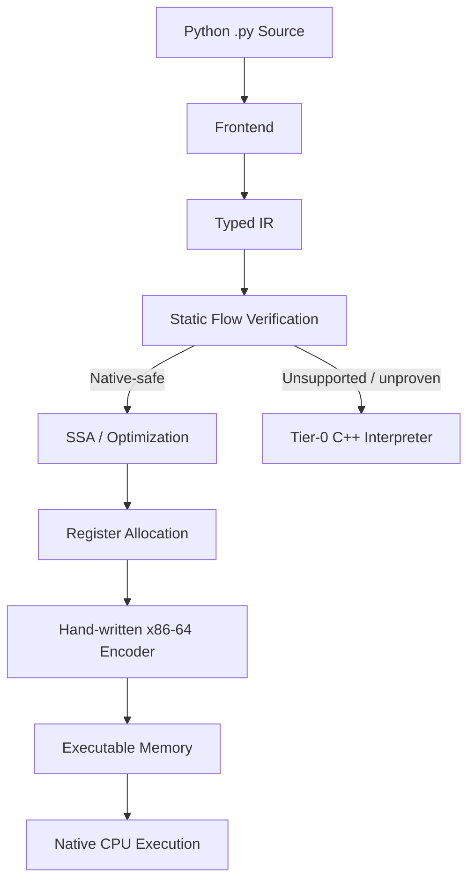

<div align="center">


# Lithon

### Native execution for typed Python.

[](https://github.com/Project-Lithon/lithon/actions)
[](https://en.cppreference.com/w/cpp/20)
[](https://en.wikipedia.org/wiki/X86-64)
[](#-static-typing)
[](LICENSE)

**Lithon is an experimental Python library and native x86-64 JIT that brings extended static typing, native execution, and explicit low-level memory access to Python code.**

</div>

---

<p align="center">
  
</p>

---

## 🚀 What is Lithon?

Lithon is a **Python library and native execution engine** that runs `.py`
source code using an extended **PEP-526-style static typing syntax**.

Lithon is designed to keep Python's familiar source-code model while giving
the compiler explicit type information that can be used for static verification,
native machine-code generation, and predictable execution.

Lithon is **not a separate programming language**. Python remains the source
language and `.py` remains the source format. Lithon extends the typing
information available to the compiler so that supported Python code can be
lowered to native x86-64 machine code.

For example:

```python
x: int[64] = 10
y: int[64] = 20

result: int[64] = x + y

print(result)
```

### Current status

**Lithon is an experimental/community-preview project.**

The compiler is already executing substantial typed programs natively and has
a verification suite covering machine-code encoding, ABI correctness, static
analysis, SSA, register allocation, floating point, containers, pointers,
structs, AVX2 auto-vectorization, differential testing, and randomized
fuzzing.

It is **not yet a stable production library** and should not be treated as a
drop-in Python replacement.

### Recently added

- **Raw syscalls** — `syscall(number, a1..a6) -> int[64]`, one IR instruction
  and one host trampoline that *both* tiers call, so the calling convention
  cannot drift between them. Integer arguments only; see the limitations list.
- **Iteration helpers** — `enumerate`, `zip`, `sum`, `min`, `max`, `abs`, `any`,
  `all`, and `in`/`not in` over a list. All are rewrites over the compile-time
  capacity `N`, so there is no new opcode and no runtime helper. Cross-checked
  against CPython byte for byte.
- **Real pointers** — a `ptr[T]` is a genuine host address in the interpreter as
  well as the JIT, backed by per-variable byte storage that a syscall could
  read. `ptr[struct[N]]` forms, typechecks, compares, and scales by
  `sizeof(Point)`.
- **Three type-system holes closed** — a bool literal stored into an `int`
  (`v: int[64] = True`) used to type-check clean and print `True`; a capacity-1
  list could not compile natively at all; and a loop target could silently
  change type between `for` headers.

---

## ✨ Why Lithon?

Lithon is built around several principles:

* **Python source with extended PEP-526 typing** — Lithon works directly with
  `.py` source while providing additional type information to the native
  execution pipeline.
* **Mandatory static typing** — types are verified before execution.
* **Fixed-width values** — integer widths are explicit.
* **Native execution** — supported programs can execute as generated x86-64
  machine code.
* **No mandatory LLVM/Cranelift dependency** — the backend contains its own
  machine-code encoder.
* **Interpreter fallback** — unsupported native cases can still execute through
  Tier-0 when using automatic mode.
* **Explicit unsafe memory access** — pointer variables require an `_` prefix.
* **JIT/Compiler refusal over silent miscompilation** — when Lithon cannot prove
  something, the native tier refuses it.

The last point is fundamental to the project:

> **If Lithon cannot prove that a program satisfies the rules required by its
> native backend, it should refuse native compilation rather than guess.**

---

## 🧬 A Small Lithon Program

### Static integers

```python
a:int[64] = 20
b:int[64] = 22

result:int[64] = a + b

print(result)
```

Output:

```text
42
```

The width is part of the type:

```python
x:int[8] = 127
y:int[16] = 32000
z:int[64] = 9223372036854775807
```

Lithon does not silently turn these into arbitrary-precision Python integers.

Every integer width is **signed**: there is no `uint`. A negative `int[8]` /
`int[16]` / `int[32]` keeps its value when it is read back out of a list
element, a struct field, or a pointer, so `-5` stored into an `int[16]` prints
`-5`, never the zero-extended bit pattern `65531`. `bool` is the one narrow type
that is not signed: it reads back as `0` or `1`.

---

## 🧠 Static Typing

Lithon's type checker is **unconditional**.

Removing annotations does not disable verification.

For example:

```python
x = 10
```

is rejected when a declaration requires an explicit type.

Instead:

```python
x:int[64] = 10
```

The compiler also checks:

* definite assignment
* branch type compatibility
* return types
* integer widths
* narrowing conversions
* function parameters
* container element types
* pointer types
* struct field types
* enum variant and match rules
* type-function arity and expansion rules
* shift bounds
* container capacities

The principle is:

```text
Unknown / unprovable
        │
        ▼
     REFUSE
```

rather than:

```text
Unknown
  │
  ▼
Guess
  │
  ▼
     Generate potentially incorrect machine code
```

### Declaring without initializing

A declaration may omit the initializer. `x:int[8]` introduces the name and its
type without storing anything; the name starts **unassigned**:

```python
i:int[8]
i = 5
print(i)
```

This is accepted only where the name is definitely assigned before every read.
Reading it first is refused:

```text
RCR error: 'i' is not definitely assigned here (V1_SPEC 0.6.10)
```

An assignment inside one branch of an `if` does not count after it unless the
other branch assigns too, and a loop body never leaves a name assigned after the
loop. The first assignment is still range-checked, and the declaration emits no
code, so this generates exactly the same machine code as writing the initializer
in the declaration:

```python
i:int[8]
i = 5
print(i)
# same machine code as i:int[8] = 5 followed by print(i)
```

Re-declaring a name with a different type is refused: a name has one type.

---

## 🧷 Typed Pointers and Explicit Unsafe Variables

Lithon provides typed pointer values:

```python
i:int[16] = 16
_ptrI:ptr[int[16]] = addressof(i)

print(_ptrI)
print(valueof(_ptrI))
```

Example output:

```text
0x7fff330710e8
16
```

### Why the `_` matters

The `_` prefix is **mandatory** for pointer variables.

```python
_ptrI:ptr[int[16]] = addressof(i)
```

is valid.

A pointer variable without the required `_` prefix is rejected and does not
execute.

Likewise, a `_`-prefixed variable must satisfy the pointer rules.

This is Lithon's explicit unsafe-memory marker: the programmer can immediately
see which variables belong to the raw/native memory domain.

The mechanism is intentionally different from Rust's `unsafe` blocks, but the
design goal is similar:

> **Make potentially unsafe memory operations explicit instead of invisible.**

Current pointer support includes:

* `ptr[T]`
* `addressof()`
* `valueof()`
* typed pointer arithmetic
* compiler-enforced `_` naming
* static pointee typing
* protection against pointer promotion into ordinary registers
* frame-backed address stability

Pointers currently have deliberate restrictions. They cannot arbitrarily cross
function boundaries, point into unsupported containers, or be used as a generic
escape mechanism.

---

## ⚡ Native x86-64 Execution

Lithon's Tier-1 backend generates native x86-64 machine code directly.

The backend includes:

* hand-written x86-64 instruction encoding
* register allocation
* liveness analysis
* SSA / Phi handling
* branch emission
* stack-frame management
* floating-point SSE2 operations
* ABI-aware function calls
* CPU feature detection
* executable memory management

The generated code is placed into executable memory using the host operating
system's native facilities such as `mmap` / `VirtualAlloc`.

Lithon does **not** require LLVM or Cranelift to generate its native machine
code.

---

## 🏗️ Architecture

Lithon currently spans four implementation layers:

| Layer        | Language | Responsibility                                       |
| :----------- | :------- | :--------------------------------------------------- |
| **Frontend** | Python   | Source syntax, annotations, AST → IR                 |
| **Engine**   | C++20    | IR, type checking, analysis, optimization, execution |
| **Bridge**   | C        | ABI / native interoperability                        |
| **Backend**  | x86-64   | Machine-code encoding and emission                   |



---

## 🔀 Dual-Tier Execution

Lithon has two execution tiers.

### Tier-1 — Native

The preferred path.

```text
Lithon source
    ↓
Typed IR
    ↓
Static verification
    ↓
Optimization
    ↓
Register allocation
    ↓
x86-64 machine code
    ↓
CPU
```

### Tier-0 — Interpreter

The fallback path.

If a program uses functionality that the native backend cannot currently
support, automatic mode can execute it through the C++ interpreter.

This is useful during language development because unsupported features do not
have to block the entire execution pipeline.

### Strict mode

Use:

```bash
lithon program.py --strict
```

`--strict` means:

> **Native execution only. Refuse if Lithon cannot compile the program to the
> native tier.**

This is particularly useful for testing the compiler because successful output
cannot hide an interpreter fallback.

---

## 📦 Python Package

Lithon is being developed as a **Python library / package**, with a command-line
interface for compiling and running Lithon programs.

The project is **not yet released as a stable PyPI package**.

During development, the repository can be installed in editable mode:

```bash
pip install -e .
```

Then:

```bash
lithon program.py
```

Useful commands:

```bash
lithon program.py
lithon program.py --strict
lithon program.py --ir
lithon program.py -v
```

The current development package layout is still being consolidated before the
first public package release.

---

## ⚡ Quickstart

### Requirements

* CMake ≥ 3.20
* C++20 compiler
* Python ≥ 3.10
* x86-64 Linux or Windows environment for the current native backend

The C++ engine itself does not depend on LLVM or Cranelift.

### Build

```bash
git clone git@github.com:Project-Lithon/lithon.git
cd lithon

cmake -B build -DCMAKE_BUILD_TYPE=Release
cmake --build build -j$(nproc)
```

### Run through the development CLI

```bash
pip install -e .

lithon tests/programs/float.py
```

Native-only:

```bash
lithon tests/programs/float.py --strict
```

Print IR:

```bash
lithon tests/programs/float.py --ir
```

Verbose execution information:

```bash
lithon tests/programs/float.py -v
```

---

## 🧪 Verification

Lithon places unusually strong emphasis on **differential testing and
machine-level verification**.

The project does not consider "the program printed the expected number" enough
to prove that the native backend is correct.

The verification suite checks several independent layers.

### Current verification highlights

| Area                                 |         Current result        |
| :----------------------------------- | :---------------------------: |
| CTest                                |       **33 / 33 passed**      |
| x86-64 encoder comparisons           |        **9,931 cases**        |
| Incorrect encoder cases              |             **0**             |
| Typed differential fuzzing           |      **300 / 300 passed**     |
| Bitwise / shift fuzzing              |      **200 / 200 passed**     |
| Conditional-expression / SSA fuzzing |    **200 / 200 per suite**    |
| Direct float Phi sweep               | **38 matched / 0 mismatched** |
| ABI modules audited                  |             **34**            |
| ABI stack/callee-saved failures      |             **0**             |
| Typed regression suite               |       **24 / 24 passed**      |
| General regression suite             |       **34 / 34 passed**      |
| Type-checker unit checks             |          **145 ok**          |
| Error-code discipline checks         |          **86 ok**           |
| Tier differential (interp vs JIT)    |      **159 / 159 passed**     |
| Syscall hook parity (both tiers)     |        **4 / 4 passed**      |
| SIMD vectorizer loop cases           |        **6 / 6 passed**      |
| SIMD vectorizer gate + fallback      |          **verified**          |

The full verification gate concludes:

```text
ALL CHECKS PASSED
```

### Encoder verification

The hand-written x86-64 encoder is compared against GNU `as`.

Current comparison:

```text
9239 instruction cases
7949 byte-identical
1290 different but valid encodings
0 incorrect encodings
```

A byte difference is not automatically considered an error because x86-64
often has multiple valid encodings for the same instruction.

The important number is:

```text
WRONG = 0
```

### Differential testing

Native output is compared against the Tier-0 interpreter.

This catches errors where:

```text
compiler accepts program
        ↓
machine code executes
        ↓
but machine code produces wrong result
```

Randomized programs are generated specifically to exercise:

* arithmetic
* control flow
* SSA merges
* loops
* floating point
* bitwise operations
* shifts
* modulo
* register allocation
* optimization passes

### ABI verification

The native backend checks:

* stack alignment
* call boundaries
* return boundaries
* callee-saved register preservation

Compiled modules are disassembled and audited rather than merely assumed to
follow the ABI.

---

## 🧮 Floating Point

Lithon currently supports `float[64]` through the native pipeline.

Supported operations include:

* addition
* subtraction
* multiplication
* division
* modulo
* comparisons
* function arguments
* function return values
* native printing

The implementation uses SSE2 instructions and performs explicit handling for
cases such as:

* NaN comparisons
* NaN divisors
* positive and negative zero
* division by zero
* floating-point formatting
* values crossing function calls

Float formatting is shared between the interpreter and native runtime so that
both tiers produce identical textual output.

---

## 📚 Containers

### Lists

Fixed-capacity lists are supported:

```python
xs:list[int[32],4]
```

The capacity is static and the layout is packed according to element width.

Currently supported list operations include:

```python
xs:list[int[32],4]

xs[0] = 10
xs[1] = 20

print(xs[0])
print(len(xs))
```

Bounds are statically checked when possible and dynamically trapped when the
index is only known at runtime.

### Tuples

Homogeneous immutable tuples are supported:

```python
t:tuple[int[64],4] = (1, 2, 3, 4)

print(t[2])
```

Tuple construction must initialize all elements.

Writes after construction are rejected by the type checker.

### Dictionaries

Fixed-capacity dictionaries use open addressing:

```python
d:dict[int[64], int[64], 4] = {
    1: 10,
    2: 20
}
```

The table has a compile-time capacity and does not require a dynamically growing
heap structure.

Supported operations include:

* literal construction
* lookup
* `contains`
* fixed-capacity hashing
* collision resolution
* deterministic miss traps

Mutation after construction is intentionally not currently supported.

---

## 🧱 Structs

A struct is a named run of typed fields packed into one blob of bytes. It is
spelled as a class deriving from `Struct`, whose body is nothing but field
annotations:

```python
class Point(Struct):
    x: int[64]
    y: int[64]

p: Point
p.x = 3
p.y = 4
print(p.x)
print(p.y)
```

The declaration `p: Point` reserves and zeroes the bytes. A struct **has no
value** — the only operations are reading and writing fields, and the whole
struct is never an expression you can print or assign.

Fields are laid out end to end at exactly the offsets their sizes imply, with
**no padding** (a `bool` is 1 byte, `float[64]` is 8, `int[w]` is `w / 8`), so
the layout is a pure sum of field sizes and matches a C `#pragma pack(1)`
struct byte for byte.

```python
class SockAddrIn(Struct):
    family: int[16]   # offset 0
    port: int[16]     # offset 2
    addr: int[64]     # offset 4
    active: bool      # offset 12

s: SockAddrIn
s.family = 2
s.port = 80
s.addr = 16909060
s.active = True
```

A field may be a scalar (`int[w]`, `float[64]`, `bool`) or a struct declared
earlier; a nested struct is flattened, so `seg.a.x` is a single read at the
summed byte offset. Containers, pointers, whole-struct values, and struct
parameters/returns are refused.

`tools/check_struct_layout.py` compiles the same struct definitions with a C
compiler and asserts the frontend's offsets and sizes equal the C
`offsetof`/`sizeof` values, field by field.

---

## 🏷️ Enums

An enum is a tagged union: a byte blob holding an `int` tag plus room for the
payload of whichever variant is active. Like a struct it **has no value** —
the only operations are constructing a variant, reading the tag with `match`,
and reading a payload through the arm's binding. It is spelled as a class
deriving from `Enum`:

```python
class Shape(Enum):
    Empty
    Dot
    Line: int[32]
    Rect: int[64]

s: Shape
s = Shape.Dot
match s:
    case Shape.Empty:
        print(0)
    case Shape.Dot:
        print(1)
    case Shape.Line(n):
        print(n)
    case Shape.Rect(w):
        print(w)
```

A variant is a bare unit name (`Empty`), a `name: type` scalar payload
(`Line: int[32]`), or an inline `class V(Struct)` struct payload. The layout is
`[tag][payload]` with **no padding**: the tag is an `int[8]` while the enum has
at most 128 variants and widens to `int[16]` past that, the payload starts at
the tag width, and the size is the tag width plus the largest payload. Only the
active variant's bytes are ever read, so overwriting a payload variant with a
smaller one leaves stale bytes that no `match` can observe.

A `match` must be exhaustive — every variant covered, or a final `case _:`. It
lowers to a tag `fieldload`, an equality test, and a branch per arm, reusing the
struct machinery; there is no new IR. A struct field may be an enum
(`c.proto = Endpoint.Tcp(port=8080, addr=16777343)`), but list elements, enum
parameters/returns, enum-typed payloads, and `case` guards are refused.

`tools/check_enum_layout.py` compiles an equivalent C `#pragma pack(1)`
tag-plus-union and asserts the frontend's tag width, payload offset, and size
equal the C `offsetof`/`sizeof` values at both tag-width boundaries.

---

## 🔧 Methods

A `def` inside a struct or enum body is a **method**. The first parameter is the
implicit receiver `self`; the rest are annotated scalars, and the return type is
optional. A method is called as `recv.name(args)`.

```python
class Counter(Struct):
    value: int[64]

    def add(self, n: int[64]) -> int[64]:
        self.value = self.value + n
        return self.value

    def total(self, n: int[64]) -> int[64]:
        t: int[64] = 0
        i: int[64] = 1
        while i < n + 1:
            t = t + i
            i = i + 1
        return t


c: Counter
print(c.add(5))
print(c.total(4))
```

A method call is **inlined at the call site**: `self` becomes the receiver place,
the method's parameters and locals are renamed so they cannot collide with the
caller's, and its `return` stores the result and jumps to the end of the inline.
Inlining is forced by the storage model — a field access names a variable, not a
value, and a struct or enum cannot be passed to a function (E0124) — and it is
what lets a method read *and write* the receiver's fields, keep its own locals,
run loops and branches, and call other methods. The receiver can be a struct or
enum variable or a struct/enum field (`o.inner.bump(1)`), and an enum method
reads `self` with `match self`.

Because the body is expanded at each call site, a method cannot recurse,
directly or indirectly (E0135). A method signature is scalars only
(`int[w]`/`float[64]`/`bool`): a method may not take or return a struct, an
enum, a container or a pointer, and `self` is unannotated. There is no
inheritance or overloading, a method name may not shadow a field or a variant,
and the signature accepts no `/`, `*`, `**` or defaults (E0134).

```python
class Shape(Enum):
    Empty
    Line: int[32]

    def code(self) -> int[64]:
        match self:
            case Shape.Empty:
                return 0
            case Shape.Line(n):
                return n
            case _:
                return -1
```

`tools/check_methods.py` proves the transparency claim: it compiles a
method-using program and the same program with the bodies inlined by hand and
requires both tiers to produce identical output, checks the IR is deterministic,
and checks the E0134/E0135 refusals.

---

## 🧩 Type Functions

A type function is a **compile-time type constructor**: `def Name(params) ->
NewType` returns `{ T }`, and writing `Name(args)` anywhere a type is allowed
substitutes the arguments into `T` and yields an ordinary type.

```python
def Fixed(t, n) -> NewType:
    return {list[t, n]}

def Word() -> NewType:
    return {int[32]}

def Ref(t) -> NewType:
    return {ptr[t]}

xs: Fixed(int[64], 4)      # == list[int[64], 4]
w: Word()                  # == int[32]
_p: Ref(int[64])           # == ptr[int[64]]
```

The result is **structural** — `Alias(int[64])` and `int[64]` are the same
type, so nothing about a type function survives into the IR: compiling the
program above and the same program with the three types spelled out produces
byte-identical IR. The parameters hold **types and sizes** (they are
unannotated names), not runtime values; a definition carries no code and is
invisible to the runtime.

Applications nest (`Pair(Word())`) and work anywhere an annotation does:
function parameters and returns, struct fields, and container element types.
The body must be exactly one `return { <type> }` — `{}` is a dict and is
refused, as are multi-element bodies, comprehensions, decorators, annotated or
defaulted parameters, redeclarations, and names that collide with a struct, an
enum or a function. A body composes the value types an annotation can spell —
scalars, containers, pointers and dicts — and may not name a struct or an enum,
which are storage rather than values. A type function must bottom out in a
concrete type, so direct and mutual recursion are refused.

`tools/check_typefunc.py` proves the structural claim: it compiles a
type-function program and its spelled-out equivalent and requires the IR to be
byte-identical, then checks memoization and the E0132/E0133 refusals.

---

## 🧠 SSA and Optimization

Lithon's compiler is progressively moving from a memory-based IR toward SSA.

Current components include:

* CFG construction
* dominator analysis
* natural-loop analysis
* loop canonicalization
* Phi placement
* Mem2Reg
* SSA copy propagation
* dead-value elimination
* liveness analysis
* interference-graph register allocation
* Phi register coalescing
* direct Phi lowering
* constant folding
* dead-code elimination
* loop strength reduction
* accumulator unrolling
* optional floating-point reassociation
* AVX2 auto-vectorization of int32 loop bodies (CPUID-gated scalar fallback)

### Direct Phi support

Phi handling is now implemented as an opt-in native path:

```bash
lithon program.py --strict
```

with the compiler's direct-Phi development path available through the relevant
backend flags.

The default memory-based lowering remains available because the project uses
the two paths as a differential-testing surface.

### Floating-point reassociation

Lithon deliberately keeps floating-point reassociation **off by default**.

The opt-in:

```bash
--ffast-math-equivalent
```

can shorten floating-point dependency chains, but it may change the numerical
result.

For example:

```text
interpreter                     2.0
native                          2.0
native --ffast-math-equivalent  1.0
```

This behavior is intentional and documented rather than hidden behind a generic
"optimization" switch.

---

## ⚡ SIMD Auto-Vectorization

The native backend can fuse a canonical elementwise or reduction loop over a
fixed-capacity `int[32]` list into **8-wide AVX2** lanes.

The compiler recognizes the range-loop shape the `while`/`for` lowering
produces — a small rotatable header (`i < N`), a straight-line body with a
single element read/write and one integer op, and a `i = i + 1` latch — and
replaces it with:

* a **CPUID gate** (`has_avx2()`), read from an int32 constant pool appended
  to the module;
* an 8-wide **vector main loop** of `vmovdqu` / `vpaddd` | `vpsubd` |
  `vpmulld` over `N - N%8` elements (reductions run a `vpxor` +
  `vextracti128` + `vpshufd` halving merge);
* a scalar **tail** for the last `N%8` elements;
* the untouched **scalar header as a fallback**, so on any host without AVX2
  the exact scalar code path still runs.

Key properties:

* The vector slices are byte-for-byte what the encoder emits and
  `check_encoder_vs_as.py` verifies; the unit test re-encodes the register
  core and proves the bytes are present, and absent from the scalar build.
* 32-bit lanes are **exact** for every program the typechecker accepts: only
  `int[32]` lists vectorize, so no wider-than-lane math can be reordered into
  a different overflow.
* Reductions are recognized only when the accumulator really is `int[32]`
  (verified from IR width annotations), so the 32-bit lane adds and the
  horizontal merge re-widen exactly.
* `vzeroupper` is emitted before any `Call` or `Return` in a function that
  used the vector path (audited by `check_vex_transitions.py`).
* `--no-vectorize` disables the pass; it also needs loop rotation, so
  `--no-rotate` disables it too (the fallback header is the rotated back edge).

A loop the recognizer cannot prove safe is left scalar — the vectorizer
refuses rather than guesses.

---

## `%` Is Not Python's `%`

Lithon deliberately uses **C-style truncating remainder semantics**.

```python
print(-7 % 3)   # Lithon: -1
print(7 % -3)   # Lithon: 1
```

CPython instead uses floor-division semantics:

```text
Lithon / C-style:  remainder follows the dividend
Python:            remainder follows the divisor
```

This is an intentional language-design decision.

---

## 🔀 Integer Operations and Shifts

Integer operations operate on fixed-width machine integers.

Supported bitwise operators:

```python
&
|
^
<<
>>
```

Right shift is arithmetic.

Shift counts must remain within the valid machine range:

```text
0 <= shift < 64
```

A constant invalid shift is rejected at compile time, while a dynamic invalid
shift traps at runtime rather than relying on x86's implicit masking behavior.

This keeps the language semantics explicit instead of accidentally inheriting
the CPU's register-level behavior.

---

## 🔌 Raw Syscalls

Lithon can invoke the platform's raw syscall primitive directly:

```python
uid: int[64] = syscall(102)   # getuid() on Linux/x86-64
```

`syscall(number, a1, a2, a3, a4, a5, a6)` takes a syscall number and up to six
arguments and returns the kernel's **raw** result as `int[64]`. On Linux a
failure is a negative `-errno`; nothing is wrapped and nothing is checked — a
program that wants to handle failure compares the result itself. There is no
`syscall` function to import: it is a compiler-recognized name that lowers to a
single `Syscall` IR instruction.

Both tiers execute it through one shared host trampoline
(`src/jit/syscall_runtime.h`), so the calling convention cannot drift between
the interpreter and the JIT. That trampoline consults an embedder-installed
hook first, on every platform; with no hook it runs the actual x86-64 `syscall`
instruction on Linux, and on a platform whose raw ABI is not stable (Windows)
returns `-ENOSYS` rather than guessing.

**Current restriction:** arguments are integers in this slice. A pointer
argument is refused at typecheck, because the interpreter represents pointers as
synthetic addresses rather than real memory, so a syscall that takes a pointer
(`write`, `read`) could not behave the same in both tiers. Pointer-taking
syscalls are deferred until the interpreter grows a real address-space story.

---

## 🛡️ Safety Philosophy

Lithon is not trying to eliminate low-level programming.

It is trying to make low-level programming **explicit and statically
constrained**.

The compiler therefore prefers:

```text
prove → compile
```

over:

```text
guess → compile → hope
```

Examples include:

* mandatory variable annotations
* fixed-width integers
* static narrowing checks
* definite-assignment analysis
* fixed container capacities
* packed, statically-laid-out structs
* typed pointers
* explicit `_` pointer naming
* compile-time shift validation
* ABI verification
* native/interpreter differential testing

The unsafe-memory model is intentionally visible:

```python
_ptr:ptr[int[64]]
```

rather than hiding the fact that a variable contains a raw address.

---

## 🆚 How Is Lithon Different?

| Feature               | CPython              | Cython / mypyc              | PyPy           | **Lithon**                |
| :-------------------- | :------------------- | :-------------------------- | :------------- | :------------------------ |
| Syntax                | Python               | Python                      | Python         | **Python `.py` + Extended PEP-526**           |
| Primary execution     | Bytecode interpreter | C extensions                | Tracing JIT    | **Native x86-64**         |
| Static typing         | No                   | Optional                    | No             | **Mandatory**             |
| Fixed-width integers  | No                   | Possible                    | No             | **Built-in**              |
| Raw typed pointers    | No                   | Via C                       | No             | **Built-in**              |
| Native backend        | No                   | C/C++                       | JIT runtime    | **Custom x86-64 emitter** |
| LLVM required         | No                   | No                          | No             | **No**                    |
| Interpreter fallback  | Yes                  | N/A                         | Yes            | **Yes**                   |
| SSA compiler pipeline | No                   | External/compiler-dependent | Internal JIT   | **Yes**                   |
| Current target        | Cross-platform       | Cross-platform              | Cross-platform | **x86-64**                |

Lithon is not intended to replace Python's enormous ecosystem.

Instead, it explores a different point in the design space:

> **What if Python code could retain its familiar source model while giving the
> execution engine explicit static types, fixed-width values, native execution,
> and controlled low-level memory access?**

---

## 🎯 Potential Use Cases

Lithon is particularly interesting for programs where predictable native
execution matters:

* numeric algorithms
* tight computational loops
* low-latency utilities
* systems-oriented tooling
* performance-sensitive data processing
* experimental compiler research
* native execution experiments
* educational work involving compilers and machine code

Performance claims should always be treated as workload-dependent.

Lithon is **not** currently claiming that every Python program will run faster
than CPython, PyPy, Cython, Rust, or C++.

---

## 🔢 Iteration Helpers

`enumerate` and `zip` work in a `for` header:

```python
for i, x in enumerate(xs):
    print(i)
    print(x)

for a, b in zip(xs, ys):
    print(a)
    print(b)
```

Neither is a value. Both are a **rewrite of a counted loop** over constructs that
already exist: `for i, x in enumerate(xs)` becomes `for i in range(N): x = xs[i]`,
and `for a, b in zip(xs, ys)` becomes the same loop bounded at `min(N1, N2)` — a
compile-time constant, because the declared capacity is what `len()` folds to.
So there is no new opcode and no runtime helper; `zip` costs nothing beyond the
indexed loads it already emits.

Two consequences worth stating plainly:

- **`zip` stops at the shortest input**, exactly as Python does. `zip(xs, ys)`
  over a `list[..., 6]` and a `list[..., 3]` runs three times.
- **`enumerate` and `zip` are for-header only.** `z = zip(a, b)` is refused: the
  pair never needs to exist as a value, and a homogeneous tuple could not
  represent `enumerate`'s `(int, T)` anyway.

Elements bind with their declared type, so a `float[64]` list yields floats and
a `list[int[16], N]` stays signed. `break` and `continue` work inside either
header, because the rewrite is a real loop.

### 🧾 Divergences from Python

Deliberate narrowings, collected next to `%` and `v == n`:

| Construct | Python | Lithon | Why |
|---|---|---|---|
| `%` | remainder, sign follows the divisor | truncation toward zero; zero divisor traps (`E0301`/`E0302`) | signed machine remainder is not total |
| `v == n` | value equality | not supported | equality on machine values has no total answer |
| `zip` / `enumerate` | first-class iterators, usable as values | for-header only | a rewrite of a counted loop; the pair is never a value |
| `x in xs` on a list | membership, over any element type | membership over int/float lists only | it lowers to `==`, which does not take bools yet |
| `v in xs` on a `bool` list | membership | refused | same `==` restriction |
| `print(a, b)` | space-separated, one trailing newline | exactly one argument | a separator + `end` needs a no-newline print variant |
| `print(_p)` | a stable address | prints an address, but it differs per tier | real addresses cannot be byte-comparable across tiers |
| a dangling `_p` | undefined | undefined, and now a `SIGSEGV` | out of scope by design, not tracked by the compiler |
| string literals | `str` | not supported yet | `str[N]` is Phase 6.2: N must be a declared capacity |

---

## 🧭 Roadmap

```text
              Current
                 │
                 ▼
       ┌─────────────────────┐
       │ Dual-Tier Native JIT│
       │ Static Type System  │
       │ SSA / Optimizations │
       │ x86-64 Backend      │
       └──────────┬──────────┘
                  │
                  ▼
       ┌─────────────────────┐
       │ AOT Compilation     │
       │ Standalone Binaries │
       └──────────┬──────────┘
                  │
                  ▼
       ┌─────────────────────┐
       │ Hardware / Systems  │
       │ Integration         │
       │ SIMD / Syscalls     │
       └─────────────────────┘
```

### Phase I — Native compiler

* [x] Dual-tier execution
* [x] Static type flow verification
* [x] Hand-written x86-64 encoder
* [x] Register allocation
* [x] SSA pipeline
* [x] Floating-point pipeline
* [x] Lists
* [x] Tuples
* [x] Fixed dictionaries
* [x] Typed pointers
* [x] Packed structs
* [x] ABI verification
* [x] Differential testing
* [x] Randomized compiler fuzzing
* [x] CPU feature detection
* [x] VEX instruction encoding
* [x] AVX2 / SIMD vectorization
* [x] SIMD reductions

### Phase II — AOT

* [ ] ELF64 generation
* [ ] PE32+ generation
* [ ] Standalone native executables
* [ ] Runtime-independent deployment

### Phase III — Systems / hardware integration

* [x] Direct syscall emission (raw `syscall(number, a1..a6) -> int[64]`,
  integer arguments; pointer-taking syscalls deferred)
* [ ] Expanded raw-memory operations
* [ ] Expanded native FFI
* [ ] ARM64 backend

### Phase IV — Python-familiar surface

* [x] Iteration helpers: `enumerate`, `zip` (for-header only; a rewrite of a
  counted loop, no new IR)
* [x] `sum` / `min` / `max` / `abs` / `any` / `all`, and `in` over a list — also
  rewrites over the compile-time capacity `N`; `min`/`max` select through the
  if-expression diamond, `abs` is `-v if v < 0 else v`
* [ ] Multi-argument `print` with a separator and `end`
* [ ] `str[N]` bounded strings and string literals
* [ ] f-strings (in `print` first, then as a value)
* [ ] `str.find` / `str.count`
* [ ] `str.split` and `list.append` (both need the list length field)
* [ ] `x in xs` over a `bool` list — refused because it lowers to `==`, which
  does not take bools yet (the same refusal as `a == b` on two bools)

---

## 📍 Current Known Limitations

Lithon is powerful on its supported subset, but its native execution engine is
still experimental.

Current limitations include:

* x86-64 is the primary native backend.
* ARM64 is not yet implemented.
* Native calls carry the first two arguments in registers and the rest on the
  stack, up to `kMaxParams` (currently 32); a call with more arguments than that
  makes the native tier refuse rather than mis-pass them.
* Some container operations remain intentionally restricted.
* Pointer values have strict restrictions around function boundaries and
  container access.
* Some SSA/native paths remain opt-in or have known unsupported cases.
* **Field access through a pointer (`valueof(_p).x`) works in the interpreter
  only.** The IR, parser, type checker and interpreter are done and proven — a
  write through a pointer is read back through the name — but the JIT has no
  `[reg+disp]` encoder primitive yet, so the native tier refuses these
  instructions and falls back to the interpreter rather than miscompile them.
  This is the one blocker for 5.2, whose `send`/`recv` buffers are
  `ptr[int[8]]` into struct memory.
* `ptr[Point]` forms, typechecks, compares, and scales by `sizeof(Point)`, but
  cannot yet be read or written through natively (see above). Struct and enum
  pointees, `self` as `ptr[Point]`, and the optimizer alias barriers for
  address-taken variables are all still to come.
* **Dangling pointers are out of scope by design.** The compiler does not track
  a pointer's lifetime against what it points at, so dereferencing freed or
  out-of-bounds memory is undefined — and now that pointers are real addresses,
  a wild dereference is a `SIGSEGV` in the interpreter too, not a deterministic
  trap. This is a stated choice, not a silent gap: the programmer proves the
  math, the types and the constraints, never the memory location.
* **A printed pointer value is not comparable across tiers.** The interpreter's
  arena addresses and the JIT's frame addresses differ, and ASLR moves them
  between runs. Pointer arithmetic, comparison of two pointers into the same
  object, and `valueof` *are* tier-consistent; the raw number is not. Programs
  that print a pointer are excluded from the tier-diff oracles.
* `syscall(...)` accepts integer arguments only; pointer-taking syscalls
  (`write`/`read`) are not yet supported because the interpreter's pointers were
  synthetic addresses rather than real memory.
* AVX2 vectorized code is emitted and byte-verified everywhere, but it is only
  *executed* on hosts that report AVX2; on other hosts the CPUID gate always
  takes the scalar fallback, so vector execution itself is not exercised there.
* There is no production AOT compiler yet.
* The PyPI package has **not yet received its stable public release**.
* Lithon is not intended to be a drop-in CPython replacement.

When the compiler cannot prove a construct is supported, it should refuse the
native tier rather than silently produce questionable machine code.

---

## 🧪 Testing

### Build

```bash
cmake -B build -DCMAKE_BUILD_TYPE=Release
cmake --build build -j$(nproc)
```

### Unit tests

```bash
ctest --test-dir build --output-on-failure
```

### Full verification

```bash
bash tools/verify_all.sh
```

### Regression suites

```bash
python3 tools/run_regression.py
python3 tools/run_typed_regression.py
```

### Tier differential testing

```bash
python3 tools/run_tier_diff.py
```

Every program runs twice — once through the interpreter (the oracle) and once
through the native tier — and the two stdout streams must be byte-identical.
Currently **159 / 159** cases pass, 93 of them on the native tier.

Two classes of case are deliberately outside this comparison:

- **Adversarial cases** declare which tier they *expect*, so a guard that is
  too weak (native where it must refuse) and too strict (interpreter where
  native is provably safe) both fail the run.
- **Printed pointer values** cannot be byte-comparable, because the two tiers
  address memory differently. Pointer arithmetic, comparison of two pointers
  into the same object, and `valueof` *are* compared.

Sockets are likewise outside it: they are stateful and external, so 5.2 is
verified against a raw C program doing the identical syscalls instead.

### Syscall hook parity

```bash
./build/syscall_hook_test
```

`g_syscall_hook` is consulted first on every platform, which turns the raw
syscall into a pure function of its inputs. The test installs a hook and runs
the *same* program through both tiers, requiring the hook to observe identical
arguments — which is what pins the JIT's six-slot stack staging and keeps the
two engines from drifting about the calling convention.

### Differential fuzzing

```bash
python3 tools/fuzz_diff.py --count 300
python3 tools/fuzz_diff.py --count 300 --floats
python3 tools/fuzz_diff.py --count 300 --bitwise
python3 tools/fuzz_diff.py --count 300 --phi
python3 tools/fuzz_diff.py --mod --count 300
```

### Benchmarking

```bash
python3 tools/native_bench.py --runs 30 --pin 2
```

For reliable comparisons, pin the benchmark to a CPU and compare results
generated by the same benchmark harness.

---

## 📊 Latest Benchmark

<!-- MAMBA:BENCHMARK:START -->

## ⚡ Latest Benchmark

| Benchmark | Lithon JIT | Reference | Speedup | Result |
|---|---:|---:|---:|---:|
| fib(30) | 5.6878 ms | 854.6647 ms | 150.3× | 832040 |

**Status:** PASS

_Last updated by Lithon Reporter Mamba._

<!-- MAMBA:BENCHMARK:END -->

> Benchmark results are workload- and machine-dependent. They should be
> reproduced locally before being used as general performance claims.

---

## 🤝 Community

Lithon is entering its **community-preview stage**.

If you are interested in:

* compiler construction
* JIT compilation
* x86-64 machine-code generation
* static analysis
* SSA and register allocation
* systems programming

then feedback, experiments, bug reports, and technical criticism are welcome.

The project is still evolving. In particular, feedback on the **type system,
pointer/unsafe model, compiler architecture, and language semantics** is
especially valuable.

---

## 📜 License

Lithon is released under the [MIT License](LICENSE).

> **Native execution for typed Python. Explicit by design.**

</div>
